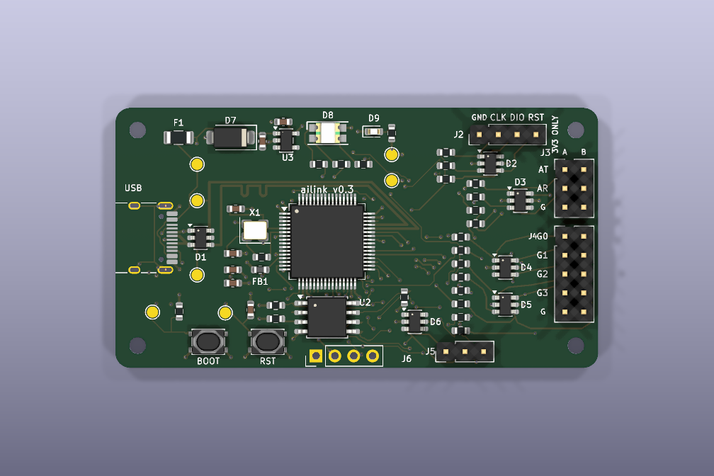

# ailink v0.3 初版单板 — 设计交付

| 项 | 内容 |
| --- | --- |
| 需求基线 | [product.md](product.md) v0.3（2026-08-29） |
| 设计工具 | KiCad 10.0.5（原理图/PCB 均为脚本化生成，可复现） |
| 交付日期 | 2026-08-30 |
| 板规格 | 65 × 35 mm，4 层（L1 信号 / L2 GND 平面 / L3 +3V3 平面 / L4 信号），1.6 mm，1 oz |
| 校验状态 | ERC 0 错误 0 警告 · DRC 未连接 0 / 铜层违规 0 · 网表与 §5.1 引脚表自动化断言全部通过 |

## 1. 交付物清单

### 工程源文件（`hardware/`）

| 文件 | 说明 |
| --- | --- |
| `ailink.kicad_pro` / `ailink.kicad_sch` / `ailink.kicad_pcb` | KiCad 10 工程，可直接打开编辑 |
| `lib/ailink.kicad_sym` | 项目符号库（W25Q64JVSSIQ，自 W25Q32JVSS 派生） |
| `sym-lib-table` / `fp-lib-table` | 库表 |

### 输出物（`outputs/`）

| 文件 | 说明 |
| --- | --- |
| `ailink-schematic.pdf` | 原理图（A2 单页，按功能分区） |
| `pcb-pdf/01~06` | PCB 分层图纸（4 铜层 + 双面丝印） |
| `renders/render-*.png` | 3D 渲染：正/反/双等轴测 |
| **`ailink-fab.zip`** | **投板用精简制造包（14 文件：4 铜层/阻焊/丝印/钢网/板框/钻孔/job/FAB-NOTES），下单以此为准** |
| `FAB-NOTES.md` | 制板必读：JLC7628 叠层、90 Ω 阻抗、**4 处 VIPPO 坐标表**、J1 丝印豁免、DNP/双面贴装、D8 上料前置条件 |
| `ailink-gerbers.zip` | 全层 Gerber + 钻孔（含 Fab/Courtyard 等工程层，存档用） |
| `ailink-bom.csv` | BOM（按值/封装分组，含 MPN/Spec 列） |
| `erc-report.txt` / `drc-report.txt` | 校验报告 |
| `ailink.net` | 网表（s 表达式） |
| `si-report.txt` | USB 差分几何报告 |
| `design-notes.md` | 设计说明：器件定型、叠层阻抗、工程偏差 |

### 评审记录（`review/`）

| 文件 | 说明 |
| --- | --- |
| `review-request.md` | 评审请求（范围与判定标准） |
| `review-round1.md` | 第一轮评审：不通过（2 Blocker + 8 Major + 3 Minor） |
| `fixes-round1.md` | 第一轮整改追踪表（含 5 项签核偏差） |
| `review-round2.md` | 第二轮评审：有条件通过（两 Blocker 均关闭，新增 2 Major 条件） |
| `review-round3.md` | 第三轮确认评审：条件核销，可投板 |

### 生成脚本（`scripts/`）

原理图生成器（`gen_sch.py`+`sch_writer.py`+`symlib.py`）、网表金标准校验（`verify_netlist.py`）、PCB 生成（`gen_pcb.py`）、USB 差分手工布线（`route_usb.py`）、电源扇出（`fanout_power.py`/`fanout_mcu.py`）、网格 A* 布线器带撕线重布（`astar_router.py`）、输出管线（`export_all.sh`）等。整板从需求到 Gerber 全流程可复现。

## 2. 板级设计要点



- **USB-C（左端）→ 目标接口（右端/下缘）** 对置布局（MR-02）；`3V3 ONLY` / `NO POWER OUT` 丝印警示（§4.13）。
- **USB 差分对**：0.35/0.15 mm（≈90 Ω @ JLC7628 叠层），L1 全程以 L2 完整地平面为参考，DP 侧梯形蛇形补偿后主路径对内长度差 **0.03 mm**（≤2 mm，ER-07/§4.3）；HRO 16P 交错焊盘按标准双 via 短接处理。
- **电源链**：VBUS → 350 mA 自恢复保险丝 → SMAJ5.0A TVS → AP2112K-3.3（600 mA，≥2× 余量，D-09）→ 内层 +3V3 平面；VCAP 2.2 µF、VDD 100 nF×4、VDDA 磁珠+1 µF+100 nF（§4.1/4.2）。
- **保护链**：全部 17 路对外信号 MCU→220 Ω→ESD→连接器（ER-04/05/§4.12）：USB 用 USBLC6-2SC6，信号组用 SRV05-4 ×5，均贴近连接器。
- **自举与救砖**：BOOT0 10 kΩ 下拉 + 按键拉高、PB2 10 kΩ 下拉不作他用、NRST 按键 + 100 nF（CR-05/06，§4.11 四条路径的硬件前提全部落实）。
- **GPIO bit2 = PA0**（唯一引脚迁移，消除 BOOT1 风险，D-04）；其余引脚与现有固件完全一致，固件仅需改 `bridge_gpio.c` 一个表项（§5.2）。
- **测试点**：VBUS / 3V3 / GND / NRST / BOOT0 / USB D+ / D−（§4.14）。
- 19 个未用 MCU 引脚原理图逐一标注 NC，不引出（ER-10）。

## 3. 评审结论（硬件专家 gpt-5.6-sol，三轮）

| 轮次 | 结论 | 要点 |
| --- | --- | --- |
| 第一轮 | 不通过 | 2 Blocker（D7 TVS 极性、HSE 晶振布局）+ 8 Major + 3 Minor |
| 第二轮 | 有条件通过 | 两 Blocker 关闭；晶振岛全 F 层 0 过孔、C14 贴 U2 背面、H4 归位右下角、USB skew 0.03 mm、丝印逐针清零；新增条件：J4-ESD 路径缩短、C14 过孔入 VIPPO、J2 GND 丝印、D8/D9 冻结 |
| 第三轮 | **条件核销，可投板** | ESD 路径 28.2→9.6~16.3 mm（全部 ≤1 过孔）核销；VIPPO 4 处坐标表核销；独立复验 ERC 0/0、DRC 铜层 0、91 网络断言、USB SI 通过 |

最终剩余的两项发布动作均为采购/下单流程项，已写入 `FAB-NOTES.md` 作为强制前置：
1. **D8 上料前**取得 FM-B3227RGBA-HG 正式规格书核对共阳与 R/G/B 脚序（不符则换等效料或修版）。
2. 投板按 `ailink-fab.zip` + JLC7628 + 90 Ω 阻抗 + 4 处 VIPPO 下单。

签核偏差 5 项（晶振下方 B 层穿越经 In1 屏蔽、SPI2 走线长度、C8/C9 距离、盘中孔 VIPPO、J1 边缘丝印豁免）详见 `review/fixes-round1.md` 与 `outputs/design-notes.md` 偏差表。

## 4. 遗留事项（需样机验证）

见 [outputs/design-notes.md](outputs/design-notes.md) 第 5 节：HV-01 LDO 温升、HV-12 信号完整性实测、HV-15 ESD 等级、连接器直/弯针二次确认、VID/PID 维持测试号。

## 5. 复现方式

```bash
# 原理图：生成 → 校验 → 导出
python3 scripts/gen_sch.py && python3 scripts/verify_netlist.py
# PCB：建板 → USB 预布 → 内层平面 → 电源扇出 → A* 信号布线
python3 scripts/gen_pcb.py && python3 scripts/route_usb.py \
  && python3 scripts/post_route.py zones-inner \
  && python3 scripts/fanout_power.py && python3 scripts/fanout_mcu.py
# （信号布线顺序详见对话记录/脚本注释）
# 全部输出物
bash scripts/export_all.sh
```
