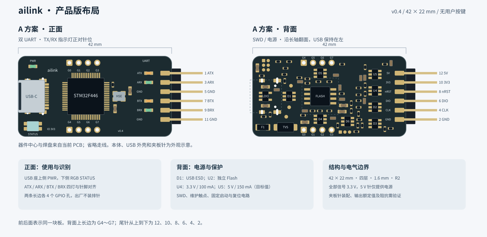
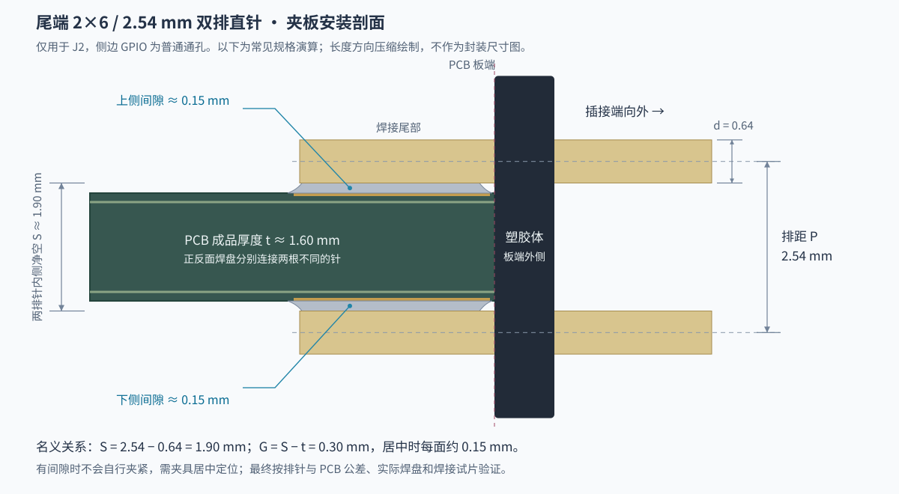

# ailink 紧凑产品 PCB 设计

| 项目 | 当前基线 |
| --- | --- |
| 修订 | v0.4，2026-09-05；用户已确认并进入工程实施 |
| 板框 | 42 × 22 mm，R2，四层，1.6 mm，无安装孔 |
| 接口 | USB-C；尾端 2×6 / 2.54 mm 夹板直针；两条长边各 4 个可选焊接 GPIO 孔 |
| 外观 | 黑色阻焊、白色丝印、ENIG；无 BOOT / RST 用户按键 |
| 实施状态 | 原理图、86 个封装的双面布局及配套固件已更新；布线与交付检查以 [DELIVERY.md](../../DELIVERY.md) 为准 |

产品电气基线见 [product.md](../../product.md)，实际工程为 [原理图](../../hardware/ailink.kicad_sch)和 [PCB](../../hardware/ailink.kicad_pcb)。本文保留外形、装配与方案细化结果；旧版 65 × 35 mm 的检查记录不覆盖新版。

## 1. 正反面布局

只保留 A 方案。背面沿板长轴翻面：USB 始终在左，尾针始终在右，上下长边互换。示意图用于说明器件布局；准确焊盘、铜层和装配尺寸以 KiCad 工程为准。

- **正面**：USB、STM32F446RET6、16 MHz 时钟岛、PWR、RGB STATUS 和四颗通信灯。用户可见面保留品牌、接口名和灯名。
- **背面**：USB ESD D1、电源保护与稳压、Flash、去耦、串阻、GPIO ESD、固定启动/复位电路、工厂和控制台触点。
- **USB 侧**：PWR 在金属座上侧，STATUS 在下侧。D1 位于数据焊脚后方的背面，避开固定焊脚与定位孔。
- **尾端**：UART 奇数针在正面，SWD 与电源偶数针在背面。四颗串口灯与各自 TX/RX 针中心线对齐，GND 针位不放灯。
- **长边**：每边只有 4 个 GPIO 镀通孔，出厂不装针。八路串阻与保护器件正常装配；单独使用 GPIO 时从 J2 取得共地。

42 × 22 mm 裸板面积为 924 mm²，比上一稿 48 × 22 mm 减少 12.5%，比旧版 65 × 35 mm 减少约 59.4%。尺寸不含 USB 外伸、夹板排针塑胶及插接段。完整封装按实际庭院放置；电阻和 100 nF 电容改为 0402，其余电容保留相应 0603 规格。

以正面板框左上角为 (0, 0)，单位 mm。背面位置仍用正面物理投影定义：

| 器件 | 面 | 中心 / 布置 |
| --- | --- | --- |
| J1 USB | F | (3.6, 11.0)，270° |
| U1 MCU | F | (18.5, 11.0)，180°；USB 引脚向左，HSE 向右 |
| X1 HSE | F | (27.6, 11.0)，180° |
| C10 / C11 / R6 | F | (26.5, 14.4) / (30.6, 9.5) / (25.9, 7.8) |
| D9 PWR / D8 STATUS | F | (4.0, 2.8) / (4.0, 19.2) |
| D10 / D11 / D12 / D13 | F | x=35.7；y=4.65 / 7.19 / 12.27 / 14.81 |
| D1 USB ESD / U2 Flash | B | (10.0, 11.0) / (18.5, 11.0) |
| U3 LDO | B | (3.5, 11.0) |
| D4 / D5 GPIO ESD | B | (18.5, 4.7) / (18.5, 17.3) |
| U4 / U5 输出保护 | B | (33.5, 12.5) / (33.5, 17.0) |
| J3 / J4 GPIO | 双面孔 | 首孔 x=14.0，其余每 2.54 递增；y=1.8 / 20.2 |
| J2 夹板针 | F / B | 板端 x=42.0；六列 y=4.65+2.54×列序（列序从 0 起） |

## 2. 接口与灯的对应关系

J2 按正面投影由上到下排列，翻面时沿用针号：

| 列 | 正面针号 / 标签 | 网络 | 背面针号 / 标签 | 网络 |
| --- | --- | --- | --- | --- |
| 1 | 1 ATX | A_TX_J | 2 GND | GND |
| 2 | 3 ARX | A_RX_J | 4 CLK | T_SWCLK_J |
| 3 | 5 GND | GND | 6 DIO | T_SWDIO_J |
| 4 | 7 BTX | B_TX_J | 8 nRST | T_nRESET_J |
| 5 | 9 BRX | B_RX_J | 10 3V3 | +3V3_OUT |
| 6 | 11 GND | GND | 12 5V | +5V_OUT |

背面图从上到下显示 12、10、8、6、4、2。ATX/BTX 为 ailink 发往目标，ARX/BRX 为 ailink 接收；nRST 为目标复位输出。所有 UART、SWD、GPIO 信号固定为 3.3 V，5 V 针只提供电源。J2 为自定义脚序，不兼容标准 Cortex 座或旧版线束。

J3 的 G0～G3 对应 PB0、PB1、PA0、PB8；J4 的 G4～G7 对应 PB9、PB10、PA1、PA8。每组首末孔中心距 7.62 mm，孔径 1.0 mm。两面丝印均按物理网络标注。

四颗 UART 灯使用独立 MCU GPIO：PC3/PC4/PC5/PC8。各灯为 3V3 → 1.3 kΩ → LED → GPIO，低有效；TX 琥珀、RX 绿，不给 UART 信号增加 LED 负载。非空 TX 成功提交后点亮，发送期间保持、完成后延长约 50 ms；非零 RX 事件保持约 50 ms。四路可同时显示。

PWR 由内部 3V3 硬件驱动。RGB STATUS 在 USB 配置有效、目标接口就绪时显示绿灯；原三色循环演示已移除。LED 具体亮度和 D8 正式共阳脚序需按实物规格及样机核对。

## 3. 无按键启动与维护

BOOT0 和 PB2/BOOT1 均为 10 kΩ 下拉，PB2 不再用作 GPIO。NRST 为 10 kΩ 上拉、100 nF 对地；RC 不作为精密上电延时。

- 正常使用：USB 上电，boot 校验 app 后自动运行。
- 日常升级：上位机请求进入 ROM DFU；固件在复位前关闭目标接口与电源输出。
- 应用镜像损坏：boot 完整时自动进入 ROM DFU。
- 首烧或返修：背面 J6 为 2×3 / 1.27 mm 探针焊盘，1=3V3、2=GND、3=MCU_SWDIO、4=MCU_SWCLK、5=NRST、6=BOOT0。治具写入 boot+app，必要时控制 BOOT0/NRST 恢复。
- J5 为控制台 TX/RX/GND 三个探针焊盘，不装用户连接器。J6 的 3V3 是本机参考电源，不能向已由 USB 供电的轨另行灌电。

## 4. 目标电源

两支路使用 TPS2553DBVR，PC9 同时使能，10 kΩ 下拉保证复位默认关闭。3.3 V 来自内部 LDO，5 V 来自 VBUS_P；输入、输出各配置 100 nF。F1 为 750 mA PTC，不能代替 USB 协议电流控制。

当前按 **3.3 V / 100 mA、5 V / 150 mA** 作为额定设计目标，均需样机验证。R36=226 kΩ、R37=147 kΩ（1%）时，含公差限流范围分别约 101～142 mA、157～213 mA。板内 134 mA 估算与两路最大限流相加约 489 mA，仍需核对真实静态电流、温度与瞬态。原 100/200 mA 建议在限流上限处约 544 mA，超出 USB 500 mA 预算，因此未采用。

USB 配置有效且未挂起时开启输出，延时约 4 ms 后恢复目标信号；复位、断开、挂起、升级时先使目标信号高阻，再关闭输出。两支路同时启停；固件不提供独立电源开关协议。目标独立供电时只接信号和 GND；使用本板供电时选匹配一路，两个输出不能接到同一目标电源节点。

TPS2553 反向电压检测不是瞬时理想隔离，约 135 mV 检测门限和 4 ms 响应期间的反向电流需要实测。AP2112K 在紧凑板上的温升、输出短路恢复和供电稳定性均需样机验证。

配套固件已实现电源时序、接口高阻、四灯、状态灯和 GPIO2→PA0；实际源码与测试见 [USB 设计](../../../ai-link/docs/design/usb-bridge.md)。USB 描述符已申报 500 mA；目前 MCU 挂起时仍运行于 180 MHz，关闭输出尚不能证明满足 USB 挂起电流要求。

## 5. D1 背面布线与层叠

L1 为正面器件/信号，L2 为连续 GND，L3 为 +3V3、少量内部信号及背面 USB 专用 GND 区，L4 为背面器件/信号。MCU 与背面 Flash 重叠区的部分内部信号使用 L3 绕出；保留 L2 连续地，L3 信号绕开 USB 地参考窗口，填铜后检查电源铜区连通。

USB 主路径从 J1 经 F/B 换层通过 D1 的流通焊盘，再回 F 面进入 U1。两种 Type-C 方向分别校验；过孔长度按实际 1.6 mm 板厚计入。D1 就近接逻辑 GND，换层附近设置连接 L2/L3 的地回流过孔。背面 USB 段下方的 L3 地区与电源铜区保持分离。

USB 主路径长度差要求 ≤2 mm。**90 Ω ±10% 为阻抗目标**；当前长度检查、局部未耦合扇出和预览叠层不能替代板厂场求解、coupon 或实测波形。HSE 信号全部在 F 面、零信号过孔。去耦、保护器件回流与电源支路线宽需随布线结果复核。

最小线宽/间距为 0.15/0.15 mm，铜到板边 0.3 mm；常规过孔 0.5/0.3 mm，USB 0.6/0.3 mm。不得缩小实际焊盘或放松板规来消除冲突。旧版盘中孔坐标不沿用。

## 6. 夹板装配与后续验证

J2 使用项目专用双面独立焊盘，不是贯穿孔；针座塑胶位于板外。以 2.54 mm 排距、0.64 mm 方针估算，内侧净空为 1.90 mm；1.60 mm PCB 居中时每侧约 0.15 mm 间隙。候选 TSW-106-07-L-D 仍须核对尾长、插接段、镀层与公差，并做同板厚焊接试片。

SMT 完成后，用夹具居中、定深、保持平行，二次焊接 J2。针尾焊盘不出锡膏，工厂触点和空置 GPIO 不进入贴片坐标。USB 和 J2 的 3D 模型仅用于外观示意，不构成供应商机械包络验证。

完成当前工程检查后，样机重点验证：

| 类别 | 验证内容 |
| --- | --- |
| 机械 | 夹板针装入与焊接、两侧 GPIO 选装、USB 插头完全插入后的灯可见性和干涉 |
| 电源 | 两路分别/同时满载、短路恢复、反灌、LDO 温升、纹波和掉电 |
| USB | 正反插、枚举前电流、挂起/恢复、启动突入、差分波形和 ESD |
| 功能 | 双 UART 与四灯、SWD、8 路 GPIO、Flash、冷启动、无按键升级与工厂恢复 |
| 性能 | 复测既有最高 11.25 Mbaud UART 与 1～12 MHz SWD 目标，旧核心板结果不直接套用 |

设计源文件可继续评审与编辑；量产前仍需完成以上实物验证、D8 规格核对、J2 装配定型及正式产品 VID/PID。
