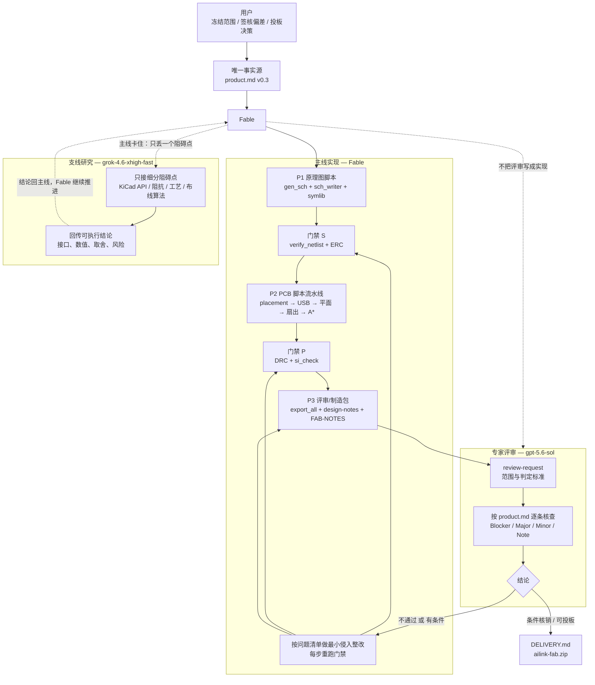
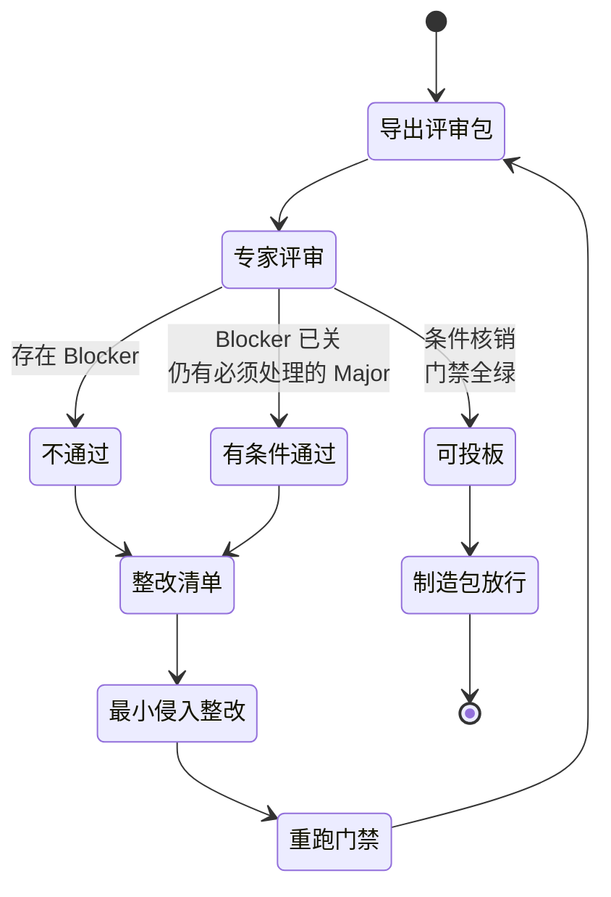

# ailink v0.3 初版单板 — 任务执行计划

> 本文是按仓库现状反推的原计划落档。需求基线、脚本主线、三轮评审与交付物均已存在；本文只还原**当时应如何分工推进**，不改设计。

## 1. 目标

把已上板验证的 ailink 固件，从「市售 F446 核心板 + 杜邦线」收敛成 **可重复制造的 65×35 mm 四层初版单板**，达到投板放行，而不是样机实测验收。

| 项 | 冻结值 |
| --- | --- |
| 需求基线 | [`product.md`](../../product.md) v0.3（2026-08-29） |
| 工具 | KiCad 10，原理图/PCB **全部脚本生成**，禁止不可复现的手改作为唯一源 |
| 板规格 | 65×35 mm，L1 信号 / L2 GND / L3 +3V3 / L4 信号，1.6 mm，1 oz |
| 唯一允许的功能引脚迁移 | GPIO bit2：PB2 → PA0（消除 BOOT1 风险） |
| 本计划不覆盖 | 外壳详设、认证、样机 HV-01～HV-15 实测、固件改协议栈 |

**可交付判定（设计文件评审，不是 HV 实测）**

- ERC `--severity-all`：0 错误 / 0 警告
- `verify_netlist.py`：§5.1 + 保护拓扑断言全部通过
- DRC：未连接 0、铜层违规 0；丝印仅允许预许豁免
- USB 主路径对内长度差 ≤ 2 mm（ER-07）
- 无未关闭 Blocker；Major 关闭或写入签核偏差
- 投板入口是带工艺说明的精简制造包，不是全层工程 Gerber

---

## 2. 任务执行架构（核心）

三人角色、两条环路：**主线实现环** 与 **专家评审环**。Fable 永远站在主线出口；研究与评审都是输入，不是新主线。



### 2.1 为什么是这张图

- 硬件交付的失败模式不是「不会画原理图」，而是 **实现者在 KiCad/阻抗/自动布线上深潜，主线停摆**，以及 **没有独立专家把关就宣称可投板**。
- 所以架构只做三件事：主线可复现、支线可委派、评审可否决。

---

## 3. 角色与边界

| 角色 | 模型 | 只做什么 | 绝不做什么 |
| --- | --- | --- | --- |
| **主线实现** | Fable | 按阶段推进脚本、门禁、整改、交付文档；拆阻碍点并收回结论 | 在支线里读手册/试算法/试第三方工具到忘记当前门禁 |
| **研究 subagent** | grok-4.6-xhigh-fast | 回答一个已写清的阻碍点，给出可执行结论 | 改板、改网表、开新阶段、替 Fable 做产品决策 |
| **专家评审** | gpt-5.6-sol | 对照 `product.md` 写分级问题清单与通过/有条件/不通过 | 自己改 `hardware/`、自己关问题、把 Note 升成实现范围 |

**Fable 委派协议（防止主线被支线吞掉）**

1. 先用一句话写清阻碍：目标、已试过的、卡在哪、需要什么形状的答案。
2. **一次只委派一个阻碍点**（或一组互不依赖的并行点），委派后立刻回到当前阶段的下一可做步骤。
3. 收回的是结论，不是对话：接口/数值/取舍/风险；Fable 自己落脚本或板文件。
4. 研究失败或超时：降级为书面签核偏差或换更粗的实现路径，不在同一点上连开多个研究会话。

典型应委派的阻碍点（从本仓库实际脚本反推）：

- KiCad 10 `pcbnew`/s 表达式写入与 ERC/DRC CLI 口径
- JLC7628 叠层上 USB 90 Ω 的线宽/间隙起点
- FreeRouting DSN/SES 与自研网格 A* 的分工（谁做全局、谁收尾）
- 晶振岛 / ESD 近端路径 / VIPPO 与盘中孔的工艺约束
- 单向 TVS 符号脚序与网表方向性断言

---

## 4. 主线工程流水线

实现主线必须是脚本，不能是「打开 KiCad 点到过」。仓库里的顺序就是原计划的流水线。


| 阶段 | 入口脚本 | 完成定义 |
| --- | --- | --- |
| P1 原理图 | `scripts/gen_sch.py` `sch_writer.py` `symlib.py` | 器件定型写入符号属性；§5.1 全表 + MCU→220Ω→ESD→连接器 可断言；ERC 0/0 |
| P1 金标准 | `scripts/verify_netlist.py` | 含方向性断言（例如 D7 阴极/阳极），不能只比两端网络集合 |
| P2 建板 | `scripts/gen_pcb.py` | 65×35、四角 M2、USB 左 / 目标右（MR-02）、4 层规则 |
| P2 USB | `scripts/route_usb.py` + `si_check.py` | L1 参考 L2；主路径 U1→J1 A6/A7；支路（TP、B6/B7）不计入 skew |
| P2 电源 | `fanout_power.py` `fanout_mcu.py` | VBUS 链、LDO 近端电容、VCAP/VDD/VDDA 扇出进平面 |
| P2 信号 | `astar_router.py`（FreeRouting 只作可选前置） | HSE / USB / 电源网列入硬网，禁止被撕；失败网可 rip+重布，禁止大范围 AABB 乱删 |
| P3 导出 | `scripts/export_all.sh` | 原理图 PDF、分层 PDF、3D、网表、BOM（MPN/Spec）、ERC/DRC、Gerber |

辅助脚本（`heal_routes` / `fix_silk*` / `fix_cluster` / `manual_routes` 等）是整改手术刀，不是第二条主线。用完必须回到门禁，并在下一轮把可复现的部分折回生成器。

---

## 5. 专家评审闭环

评审方只看导出物，不看「我改过了」的口头保证。每一轮都重新跑门禁、重新导出、重新对照 `product.md`。



**评审输入（`review/review-request.md` 口径）**

1. 引脚映射 §5.1（含 PA0 / PB2 只下拉 / NC）
2. FR-01～10 功能链完整性
3. ER-01～10 电气
4. 自举与救砖 §4.11 / CR-05/06
5. 保护链 §4.12
6. 电源与去耦 §4.2 / D-09
7. PCB §4.14 / MR 系列
8. BOM 与可制造性
9. `design-notes.md` 偏差是否可接受

**问题纪律**

- Blocker：不关不得投板（例如电源器件极性、HSE 回路不可接受）
- Major：下一轮前关闭，或量化后书面签核
- Minor / Note：不挡设计放行；Note 不得偷渡成新功能范围
- 评审只出清单；Fable 改文件并维护 `review/fixes-*.md` 追踪表

---

## 6. 阶段任务（原计划拆解）

### P0 — 冻结基线

- 以 `product.md` 为唯一需求源：覆盖/不覆盖、FR/ER/MR/CR、§5.1、§4.14、第 9 章待定项。
- 待定项只允许在同一电气边界内定型（LDO、ESD、晶振、保险丝、RGB），定型结果写入 `outputs/design-notes.md`。

### P1 — 原理图可断言

- 功能分区出图：USB/电源、MCU 最小系统、Flash、保护+连接器、人机。
- 17 路对外信号统一 `MCU → 220 Ω → ESD → 连接器`。
- 网表断言覆盖已用 33 脚、NC 19 脚、BOOT0/BOOT1/NRST、无 D+ 外挂上拉。

### P2 — PCB 可复现

- 布局：USB-C 与目标接口对置；ESD 贴连接器；晶振贴 PH0/PH1。
- USB 差分几何与叠层绑定 JLC7628，90 Ω 在 FAB-NOTES 里变成下单勾选项，而不是只写在说明里。
- 信号布线以网格 A* 收尾；关键时钟/USB/电源禁止被自动撕线误伤。

### P3 — 评审迭代到放行

- 每轮：改 → 门禁 → 导出 → 专家评 → 更新追踪表。
- 无法在不破坏板框/四角孔/平面完整性的前提下满足的项，量化后进偏差表，不假装已满足。
- 放行前把投板入口收成精简包：铜/阻焊/丝印/钢网/板框/钻孔/job + `FAB-NOTES.md`。

---

## 7. 质量门禁（每轮必跑）

```bash
python3 scripts/gen_sch.py && python3 scripts/verify_netlist.py
kicad-cli sch erc --severity-all --format report -o outputs/erc-report.txt hardware/ailink.kicad_sch

# PCB 主线见 scripts/run_pipeline.sh
python3 scripts/si_check.py
kicad-cli pcb drc --severity-all --format report -o outputs/drc-report.txt hardware/ailink.kicad_pcb
bash scripts/export_all.sh
```

| 门禁 | 通过线 |
| --- | --- |
| 网表金标准 | 断言全过（含 D7 方向） |
| ERC | 0 / 0 |
| DRC 铜层 | 未连接 0、铜层/短路/间距 0 |
| USB SI | 主路径 skew ≤ 2 mm，报告与 PCB 哈希一致 |
| 丝印 | 用户 warning 清零；仅 J1 板缘封装固有项可预许豁免 |
| 文档 | design-notes / SI / DELIVERY / FAB-NOTES 与终板同一事实，禁止口头数与文件数分叉 |

---

## 8. 交付物与放行条件

| 路径 | 角色 |
| --- | --- |
| `hardware/` | 可打开的 KiCad 10 工程（由脚本再生） |
| `scripts/` | 需求 → Gerber 的复现主线 |
| `outputs/ailink-fab.zip` | **下单以此为准** |
| `outputs/FAB-NOTES.md` | JLC7628、90 Ω、VIPPO 坐标、J1 豁免、DNP、D8 上料前置 |
| `outputs/design-notes.md` | 定型、叠层、偏差表、HV 遗留 |
| `review/` | 请求、各轮报告、整改追踪 |
| `DELIVERY.md` | 对外交付说明；投板入口只指向 fab zip |

放行后仍留在样机阶段的项（不在本计划关闭）：HV-01 温升纹波、HV-12 波形、HV-15 ESD、直/弯针二次确认、VID/PID 测试号。

---

## 9. 反推依据（执行回放）

下列产物证明原计划就是「脚本主线 + 研究委派 + 专家否决环」，而不是一次性手画板。

| 计划环节 | 仓库证据 |
| --- | --- |
| 基线先于实现 | `product.md` 写明「尚未进入原理图绘制」；器件定型回填在 `outputs/design-notes.md` |
| 原理图可断言 | `scripts/verify_netlist.py` 把 §5.1 与保护链变成 91 条网络断言 |
| PCB 流水线 | `scripts/run_pipeline.sh` 七步顺序与 §4 图一致；`astar_router.py` 写明收 FreeRouting 未完成网 |
| 主线手术刀 | `review/surgery-round1.md` 记录第一轮整改未一次达标，后续按门禁收口 |
| 专家三轮 | `review-round1` 不通过 → `round2` 有条件通过 → `round3` 条件核销；`DELIVERY.md` 写明评审方为 gpt-5.6-sol |
| 偏差不藏 | `review/fixes-round1.md` 五（六）项签核偏差与 design-notes 偏差表对齐 |
| 制造包收敛 | 第三轮要求投板入口从全层 `ailink-gerbers.zip` 收到 `ailink-fab.zip` + FAB-NOTES |

**实际闭环摘要（供对照，不是新范围）**

- 第一轮：2 Blocker（D7 极性、HSE 布局）+ 8 Major → 不通过
- 第二轮：Blocker 关闭；新增 ESD 路径 / C14 VIPPO / 丝印 / BOM / 文档条件
- 第三轮：电气条件核销；剩余 D8 规格书核对与下单工艺勾选，写入 FAB-NOTES 强制前置
- 终态门禁：ERC 0/0、DRC 铜层 0、91 网络通过、USB skew 0.03 mm
