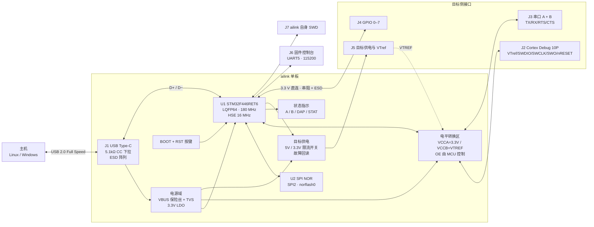

# ailink 硬件产品初版架构设计

| 项目 | 内容 |
| --- | --- |
| 文档状态 | 初版架构设计，待 review |
| 文档版本 | v0.1 |
| 更新日期 | 2026-08-13 |
| 对应固件 | `/home/huan/workspace/ailink`，提交 `4b2c890`（2026-07-29） |
| 主控平台 | STM32F446RET6，LQFP64 |
| 当前阶段 | 需求澄清与架构决策，尚未进入原理图绘制 |
| 用途 | 指导原理图、PCB 与 BOM 设计 |
| 不覆盖 | 固件实现细节（见固件仓库 `docs/design/`）；PCB 布线成品；结构件与外壳详细设计 |

本文所有引用的固件事实均标注来源文件；所有未经实测的数值均标注为估算值。第 6 章的决策项与第 9 章的待确认事项需在进入原理图设计前逐条拍板。

---

## 1. 背景

### 1.1 现有实现

ailink 固件已在 STM32F446RET6 上完成开发与上板验证，功能为「单根 USB 线同时提供两路免驱 CDC 串口、8 路 GPIO 与 CMSIS-DAP v2 调试器，并支持免调试器的 DFU 固件升级」（`README.md:3`）。

2026-07-21 性能基线（`performance-report.md`）：

| 通道 | 实测结果 | 判定 |
| --- | --- | --- |
| CMSIS-DAP v2（SWD 1～12 MHz） | 目标 RAM 写入 95.9 kB/s，读回 96.1 kB/s，25 轮字节一致 | 受 USB 命令往返限制，非 SWD 时钟限制 |
| 单路串口回环（1～11.25 Mbaud） | 6 Mbaud 起进入 USB FS 平台区，峰值 569.27 kB/s | 4 Mbaud 以下由 UART 线速决定 |
| 双路串口并发（各 11.25 Mbaud） | 两路有效载荷合计 587.63 kB/s，USB OUT+IN 1,175.27 kB/s | 无丢字节、无通道饥饿 |
| 固件升级端到端 | 123,796 B 镜像耗时均值 19.974 s，5/5 轮通过 | 升级窗口内四路通道全部离线 |

结论：**功能与协议层已闭环，USB Full Speed 总线带宽是当前的物理上限**，不是固件实现缺陷。

### 1.2 当前硬件形态的问题

现有实现运行在市售 STM32F446RET6 核心板上，配合杜邦线使用。核心板不是为本产品设计的，存在以下问题。

| 编号 | 问题 | 证据 |
| --- | --- | --- |
| P-01 | 核心板晶振实装 16 MHz，与其原理图标注的 8 MHz 不符，时钟树只能靠 `HSE_VALUE` 宏兜底 | `README.md:59`、`AGENTS.md:11` |
| P-02 | 无板载调试探针，ailink 自身首次烧录依赖外接 ST-Link | `AGENTS.md:55` |
| P-03 | 串口无 RTS/CTS 硬件流控，主机连续写入需在飞字节数限流，否则设备 RX 环（每通道 8 KB）溢出丢数据 | `README.md:25`、`docs/design/usb-bridge.md:66` |
| P-04 | 主机端口打开但持续不读超过 500 ms 后丢弃数据；文档明确「需要该场景不丢数据须 RTS/CTS 硬件流控，当前未实现」 | `docs/design/cdc-port-gating.md:31` |
| P-05 | 未实现 VTref 目标电压检测，目标板必须独立供电 | `docs/images/wiring-guide.svg:175`、`README.md:34` |
| P-06 | 所有信号固定 3.3 V 逻辑电平，禁止接入 5 V 信号；1.8 V / 2.5 V 目标无法安全驱动 | `docs/images/wiring-guide.svg:60` |
| P-07 | CMSIS-DAP 的 SWCLK=PA4、SWDIO=PA5 恰好是 STM32F446 全器件仅有的两个非 5 V 容忍引脚（I/O 结构 `TTa`，其余引脚均为 `FT` 或 `FTf`） | DS10693 Rev 10 Table 10 |
| P-08 | 8 路 GPIO 中的 bit2 落在 PB2（BOOT1）。外部电路在复位期间将该脚拉高会改变启动模式，破坏 ROM DFU 入口 | `bridge_gpio.c:27`；BOOT1 复位采样机制 |
| P-09 | 无 ESD 防护、无串阻、无连接器定义，全部靠杜邦线，11.25 Mbaud 下信号完整性无保障 | 核心板原理图 `docs/refs/sche/Schematic.pdf` |
| P-10 | 核心板 LDO 为 TPS70933（150 mA），MCU 在 180 MHz、外设全开时典型电流即 86 mA，无目标供电余量 | DS10693 Rev 10 Table 24；核心板原理图 |
| P-11 | 核心板携带 SD 卡座、LCD FPC 接口等与本产品无关的电路 | 核心板原理图 |

### 1.3 本硬件项目的目标

将 ailink 从「核心板 + 杜邦线的验证装置」转化为「可重复制造的桌面调试工具」，在保持固件架构不变的前提下，消除 P-01 至 P-11。

---

## 2. 需求基线

### 2.1 覆盖范围

- USB 供电、USB 从设备（Device only）形态的单板硬件。
- 两路 UART 桥接通道的物理接口、电平适配与流控信号。
- 一路 SWD 调试输出接口（含 nRESET、SWO 预留）。
- 8 路通用 GPIO 的物理接口与保护。
- 目标板供电输出与过流保护。
- ailink 自身的烧录、救砖与状态指示。
- 原理图、PCB 布线约束与 BOM 的需求基线。

### 2.2 不覆盖范围

- USB High Speed 或更高带宽的通道扩展（见决策 D-01）。
- JTAG 调试（固件 `DAP_JTAG=0`，`board/ports/DAP_config.h:10`）。
- 电气隔离（USB 侧与目标侧共地）。
- 逻辑分析仪、示波器、电源分析等测量功能。
- 电池供电与低功耗形态。
- 认证（CE / FCC / USB-IF）与量产测试治具。
- 外壳的详细结构设计（本文仅约束板框与安装孔）。

### 2.3 功能需求

| 编号 | 需求 | 来源 | 验证方式 |
| --- | --- | --- | --- |
| FR-01 | 单个 USB Type-C 接口同时承载两路 CDC 串口、CMSIS-DAP v2、8 路 GPIO 与 DFU 升级通道 | 固件 `README.md:3` | 枚举检查 + 四通道并发 |
| FR-02 | 串口通道 A 支持 115200～11.25 Mbaud | `docs/design/usb-bridge.md:24` | 回环压测 |
| FR-03 | 串口通道 B 支持 115200～5.625 Mbaud，并具备硬件 RTS/CTS 流控 | P-03、P-04；受 D-02 影响 | 灌数不读场景无丢字节 |
| FR-04 | 串口通道 A 引出 RTS/CTS 信号线，由固件以水位法软件驱动 | P-03；受 D-02 影响 | 同上，允许水位滞后 |
| FR-05 | SWD 接口提供 SWCLK、SWDIO、nRESET，nRESET 为开漏 | `DAP_config.h:124-136` | pyOCD / OpenOCD 连接目标 |
| FR-06 | 预留 SWO 单线跟踪输入，接入 APB2 域 UART 的 RX | 当前 `SWO=0`，硬件预留 | 硬件连通性检查 |
| FR-07 | 8 路 GPIO 方向由主机逐位配置，任一路可作输入或输出 | `bridge_gpio.c` | `ailink-gpio.py dir/set/get` |
| FR-08 | 提供目标板供电输出，5 V 与 3.3 V 各一路，均可由固件独立开关并具备过流保护与故障回读 | P-05 | 短路与限流测试 |
| FR-09 | 检测目标参考电压 VTref 并可被固件读取；VTref 缺失时目标侧收发器保持高阻 | P-05 | 目标断电时的电平测量 |
| FR-10 | 不依赖任何外部调试器即可完成空板首次烧录（bootloader + app） | P-02 | BOOT0 + dfu-util 全流程 |
| FR-11 | 保留 ailink 自身的 SWD 调试接口 | 开发需要 | ST-Link 连接调试 |
| FR-12 | 提供固件控制台串口的物理引出点 | `AGENTS.md:13` | 115200 8N1 日志可读 |
| FR-13 | 提供状态指示：串口 A 活动、串口 B 活动、DAP 活动、系统状态（含 bootloader 恢复模式常亮） | `bootloader/main.c:111-117` | 目视检查 |
| FR-14 | 保留 SPI NOR Flash 及其文件系统 | `applications/fs_init.c` | `norflash0` 挂载成功 |

### 2.4 电气需求

| 编号 | 需求 | 说明 |
| --- | --- | --- |
| ER-01 | 供电来自 USB VBUS，整机自 VBUS 取电不超过 500 mA | 按 USB 2.0 默认供电能力设计，不做 Type-C 电流等级协商 |
| ER-02 | 主 3.3 V 轨在 350 mA 负载下压降与温升满足器件规格 | 见 4.2 功耗预算 |
| ER-03 | 目标 5 V 输出限流 300 mA（典型值，待定型），目标 3.3 V 输出限流 150 mA（典型值，待定型） | 两路不得同时满载，由固件互锁 |
| ER-04 | 所有对外信号具备 ESD 防护与串联限流电阻 | 桌面工具的对外接口按可能被误接设计 |
| ER-05 | 目标侧电平适配范围 1.65～5.5 V | 受 D-03 影响，范围由所选电平转换器决定 |
| ER-06 | VTref 缺失或低于阈值时，所有目标侧输出保持高阻 | 复位期间由外部上拉实现，不依赖固件 |
| ER-07 | HSE 使用 16 MHz 晶振，频差不劣于 ±20 ppm | USB FS 要求 ±0.25%，11.25 Mbaud UART 要求更严；见 D-05 |
| ER-08 | USB D+/D− 差分阻抗 90 Ω ±10% | USB 2.0 规范 |
| ER-09 | 不得在 USB D+ 上外挂 1.5 kΩ 上拉电阻 | OTG_FS 使用片内上拉；外挂上拉会破坏软断开与 DFU 重枚举 |
| ER-10 | 目标板带电而 ailink 未上电时，不得经保护器件向 ailink 反灌供电 | 电平转换器需具备 Ioff 部分掉电特性 |

### 2.5 结构与人机需求

| 编号 | 需求 | 说明 |
| --- | --- | --- |
| MR-01 | 板框目标 65 mm × 35 mm 以内，四角 M2 安装孔 | 初步目标，待 D-08 确认连接器方案后回填 |
| MR-02 | USB Type-C 接口位于板子一端，目标侧接口集中于另一端 | 降低走线交叉与耦合 |
| MR-03 | 所有对外引脚在丝印上标注信号名与方向 | 丝印是本产品的主要人机界面 |
| MR-04 | BOOT 与 RST 为独立按键，可单手完成 DFU 进入动作 | 支撑 FR-10 |

### 2.6 固件继承约束

以下为固件当前的既成事实。硬件若不满足，则对应固件模块必须修改；每条均标注影响范围，供第 6 章决策时权衡。

| 编号 | 约束 | 来源 | 违反后果 |
| --- | --- | --- | --- |
| CR-01 | HSE 必须为 16 MHz | `stm32f4xx_hal_conf.h:108`；PLLM 由 `HSE_VALUE/2e6` 推导（`board.c:21,50`） | 需改 `HSE_VALUE`；ROM DFU 时钟自动检测范围需重新确认 |
| CR-02 | USB 使用 OTG_FS，PA11/PA12，无 VBUS 检测脚 | `docs/design/usb-bridge.md:60` | 无 |
| CR-03 | OTG_FS 的 EP0 + 5 对端点已全部占用 | `docs/design/usb-bridge.md:20` | 任何新增 USB 功能接口（MSC、第二 DAP、CAN 桥）都必须先腾出端点 |
| CR-04 | 片内 Flash 布局固定：boot 0x08000000（64 KB），app 0x08010000（448 KB） | `docs/design/ota.md:17-18` | 需重做链接脚本与 `.fw_info` |
| CR-05 | RDP 必须维持 Level 0 | `docs/design/ota.md:78` | ROM DFU 通道失效，救砖路径断裂 |
| CR-06 | BOOT0 可达且 BOOT1（PB2）在复位期间为低 | `docs/design/ota.md:86` | 无法进入 ROM DFU，空板无法烧录 |
| CR-07 | SPI NOR 挂在 SPI2，CS 为 PB12 | `board/ports/spi_flash_init.c:4-5,26` | 需改板级初始化 |
| CR-08 | bootloader 在 USART2（PA2）输出启动日志，并在跳转前复位 USART2 与整个 GPIOA | `bootloader/uart.c:1-26,67-79` | 需改 bootloader 的 UART 实例与 GPIO 端口复位目标 |
| CR-09 | bootloader 恢复模式指示灯为 PC0，低有效 | `bootloader/main.c:111-117` | 需改 bootloader 的 LED 引脚 |
| CR-10 | USB 传输缓冲需 4 字节对齐 | `usb_config.h:26` | 与硬件无关，此处仅作记录 |

---

## 3. 系统架构

### 3.1 系统框图

### 3.2 功能分区

| 分区 | 职责 | 关键器件 |
| --- | --- | --- |
| 主机接口 | USB 2.0 Full Speed 从设备、供电入口 | USB-C 座、ESD 阵列、自恢复保险丝、TVS |
| 主控 | 协议栈、四通道数据泵、DAP 位操作 | STM32F446RET6、16 MHz 晶振 |
| 电源 | 3.3 V 逻辑轨、目标供电两路限流输出 | LDO、限流负载开关 |
| 电平适配 | 3.3 V 逻辑域与 1.65～5.5 V 目标域之间的双向转换与隔断 | 方向固定收发器 ×2、单位双向收发器 ×1、开漏 MOSFET |
| 存储 | 文件系统载体，为后续离线功能预留 | SPI NOR |
| 人机 | 状态指示、启动模式控制 | 4 只 LED、2 只按键 |
| 目标接口 | 对外物理连接与保护 | Cortex Debug 10P、2.54 mm 排针、串阻、ESD |

---

## 4. 关键设计要素

### 4.1 主控与时钟

沿用 STM32F446RET6（LQFP64）。选型理由与替代方案见决策 D-01。

时钟树维持固件现状（`board.c:42-87`）：

| 项 | 值 | 约束来源 |
| --- | --- | --- |
| HSE | 16 MHz 晶振，PH0 / PH1 | CR-01；ROM DFU 的 HSE 自动检测（`docs/design/ota.md:76`） |
| SYSCLK / HCLK | 180 MHz，需 PWR Scale1 + OverDrive | `board.c:43,59-63` |
| APB1 | 45 MHz | 决定 APB1 域 UART 的 OVER8 上限为 5.625 Mbaud |
| APB2 | 90 MHz | 决定 APB2 域 UART 的 OVER8 上限为 11.25 Mbaud |
| USB 48 MHz | PLLSAI，VCO 2 MHz × 192 = 384 MHz，/8 | 主 PLLQ 无法产出 48 MHz |
| LSE | 不启用，仅保留焊盘 | 固件仅用 `RTC->BKP0R`，该寄存器在 VDD 存在时可跨软件复位保持 |

晶振选型要求：16 MHz、±20 ppm 以内、负载电容 CL 按实物选型，匹配电容按 `C = 2 × (CL − Cstray)` 计算，`Cstray` 按 3～5 pF 估算；串联驱动电阻预留 0 Ω 位置，用于起振裕度调整。

VCAP_1（LQFP64 仅此一路，pin 30）配 2.2 µF 低 ESR 陶瓷电容；4 组 VDD 各配 100 nF；VDDA 经磁珠后配 1 µF + 100 nF，VREF+ 与 VDDA 同网络；VBAT 经 0 Ω 接 3.3 V，预留电池座位置但默认不贴。

LQFP64 无 VDDUSB 独立引脚（DS10693 Rev 10 Table 10 中该行 LQFP64 列为「−」），无需额外电源域。

### 4.2 电源与功耗预算

拓扑：USB VBUS → 自恢复保险丝 → TVS → 3.3 V LDO → 逻辑域；目标 5 V 直接自 VBUS 经限流开关取出，不经 LDO。

预算（估算值，需在样机上实测修正）：

| 负载 | 电流估算 | 依据 |
| --- | --- | --- |
| STM32F446 @180 MHz，外设全开，ART 带预取 | 典型 86 mA，25 ℃ 最大 93 mA | DS10693 Rev 10 Table 24 |
| SPI NOR 读取 | 典型 5 mA，编程/擦除峰值 15 mA | 待按选定型号回填 |
| 电平转换器动态电流（SWD 12 MHz，20 pF 负载） | 合计约 10 mA | `I = C·V·f` 估算 |
| 4 只 LED | 合计 8 mA（每只 2 mA） | 按低电流 LED 设计 |
| 逻辑域小计 | 典型约 110 mA，最大约 135 mA | — |
| 目标 3.3 V 输出 | 上限 150 mA | ER-03 |
| 目标 5 V 输出 | 上限 300 mA | ER-03 |

LDO 最坏耗散：`(5 − 3.3) V × (0.135 + 0.150) A ≈ 0.48 W`。因此 LDO 必须选带散热焊盘的封装（DFN 或 SOT-223），不使用无散热焊盘的 SOT-23-5。

VBUS 总电流上限 500 mA 由 ER-01 约束，因此目标 5 V 与目标 3.3 V 两路**不允许同时满载**：硬件按各自限流值设计，固件层做互锁并在超限时关断。该互锁属于固件工作项，不由硬件强制。

### 4.3 USB 主机接口

- USB Type-C 母座，16 pin，仅 USB 2.0，不引出 SBU 与 SS 对。
- CC1、CC2 各接 5.1 kΩ 下拉，按 UFP 配置，不参与 PD 协商，不读取电流等级。
- D+/D− 走 90 Ω 差分，长度差控制在 2 mm 以内，参考层连续无分割，不打过孔换层（若必须换层则成对换层并就近加回流地过孔）。
- ESD 阵列选低结电容型（≤ 1 pF 量级），放置在座子与 MCU 之间、靠近座子。
- **不外挂 D+ 上拉电阻**（ER-09）。
- VBUS 检测不接入固件路径（CR-02），但预留一组分压电阻位置至 PA9（该脚具备 `OTG_FS_VBUS` 附加功能），默认不贴，供后续需要时启用。
- 屏蔽壳经 1 MΩ 与 10 nF 并联网络接地，单点连接。

### 4.4 目标侧电平适配与 VTref

这是相对现有核心板的最大增量，用于消除 P-05、P-06、P-07。范围由决策 D-03 确定，以下按推荐方案（SWD + 双路串口共 12 路信号做电平转换，GPIO 保持 3.3 V）描述。

结构：

| 组 | 信号 | 方向 | 器件 |
| --- | --- | --- | --- |
| OUT 组 | A_TX、A_RTS、B_TX、B_RTS、T_SWCLK（余 3 路预留） | 固定 A→B | 8 位方向固定收发器 ×1 |
| IN 组 | A_RX、A_CTS、B_RX、B_CTS、SWO（余 3 路预留） | 固定 B→A | 8 位方向固定收发器 ×1 |
| 双向 | T_SWDIO | 方向由 `SWDIO_DIR` 控制 | 单位双向收发器 ×1 |
| 开漏 | T_nRESET | MCU 侧驱动 N-MOSFET 栅极，漏极下拉目标 nRESET，目标侧 10 kΩ 上拉至 VTREF | N 沟道 MOSFET ×1 |

设计要点：

- 收发器 A 侧供电为 3.3 V，B 侧供电为 VTREF。器件必须具备 Ioff 部分掉电特性，即任一侧供电为 0 V 时对应引脚呈高阻，以满足 ER-06 与 ER-10。
- `T_SWDIO` 的方向由固件通过 `DAP_config.h` 中既有的 `PIN_SWDIO_OUT_ENABLE` / `PIN_SWDIO_OUT_DISABLE` 钩子驱动，无需改动只读的 `dap/` 参考实现。
- nRESET 采用 MOSFET 开漏方案而非收发器通道，原因是栅极由 3.3 V 驱动，与 VTREF 取值无关，在 1.8 V 目标上同样可靠。本版不做 nRESET 状态回读，若需要则占用 IN 组的一路预留通道。
- 收发器的输出使能 `LS_nOE` 接 PB4。PB4 复位默认为 JTAG 的 NJTRST 功能且带内部上拉，配合外部 10 kΩ 上拉，使复位期间与固件启动前 `LS_nOE` 维持为高、目标侧全部高阻。**该低有效极性是有意选择，不可改为高有效。**
- `SWDIO_DIR`（PB5）外部加电阻，默认置于「目标→MCU」方向，避免复位期间向目标驱动。

VTref 处理：

- VTREF 网络来自 J2（Cortex Debug）第 1 脚与 J5 排针，经 100 kΩ / 100 kΩ 分压 + 100 nF 后送 PA4（`ADC12_IN4`）。5 V 目标时分压后为 2.5 V，位于 ADC 量程内；分压网络对目标的负载约 25 µA。
- VTREF 网络加 1 MΩ 下拉，目标未接入时读数为 0，固件据此拒绝使能收发器。
- 提供 3 脚跳线 JP1 选择 VTREF 来源：外部（默认）/ 内部 3.3 V。用于连接不提供 VTref 的目标。
- 固件需新增 ADC 采样路径（当前 `HAL_ADC_MODULE_ENABLED` 未开启），属固件工作项。

### 4.5 SWD 与 SWO 接口

- 主接口为 ARM Cortex Debug 10 pin、1.27 mm 带防呆护罩连接器，标准脚序：1=VTref、2=SWDIO、3=GND、4=SWCLK、5=GND、6=SWO、7=KEY、8=NC、9=GNDDetect、10=nRESET。
- 同时引出 1×5 的 2.54 mm 排针（SWCLK / SWDIO / nRESET / GND / VTREF），用于杜邦线连接场景。两个接口并联同一组信号。
- SWCLK、SWDIO、SWO 在 MCU 侧串 33 Ω，位置靠近 MCU；nRESET 串 100 Ω。
- SWO 接入 `USART1_RX`（PA10，APB2 域 90 MHz），使后续实现 UART 模式 SWO 解码时波特率上限与串口通道 A 同级。当前固件 `SWO=0`，本项为硬件预留（FR-06）。

### 4.6 双路串口与流控

STM32F446 的 UART 流控引脚存在硬约束，直接决定了本节的方案空间。以下为数据手册核实结果（DS10693 Rev 10 Table 10）：

| UART | 时钟域 | OVER8 上限 | LQFP64 上的 CTS / RTS 可用性 |
| --- | --- | --- | --- |
| USART1 | APB2 90 MHz | 11.25 Mbaud | CTS=PA11、RTS=PA12，**与 USB D−/D+ 冲突，永久不可用** |
| USART6 | APB2 90 MHz | 11.25 Mbaud | CTS/RTS 仅在 PG8/PG12/PG13/PG15，**LQFP64 与 LQFP100 均无 Port G** |
| USART2 | APB1 45 MHz | 5.625 Mbaud | CTS=PA0、RTS=PA1，**可用** |
| USART3 | APB1 45 MHz | 5.625 Mbaud | CTS=PB13、RTS=PB14，**可用**（与当前 SPI2 引脚冲突） |
| UART4 / UART5 | APB1 45 MHz | 5.625 Mbaud | 无流控引脚 |

由此得到一条不可回避的结论：**在 STM32F446 上，只要使用 USB，两路桥接串口就无法同时具备 11.25 Mbaud 与硬件流控。** 这是本设计中最需要拍板的取舍，见决策 D-02。

推荐方案（非对称，兼顾两类需求）：

| 通道 | UART 实例 | 时钟域 | 波特率上限 | 流控 |
| --- | --- | --- | --- | --- |
| 串口 A | USART6，PC6 / PC7 | APB2 | 11.25 Mbaud | RTS/CTS 引出为普通 GPIO，由固件按 RX 环水位软件驱动 |
| 串口 B | USART2，PA2 / PA3 / PA0 / PA1 | APB1 | 5.625 Mbaud | 硬件 RTS/CTS，逐字节生效 |

软件 RTS 的可行性估算：RX 环每通道 8 KB，水位设在 50%（4 KB）时，在 11.25 Mbaud 下留出约 3.5 ms 的反应窗口，在 1 Mbaud 下约 40 ms。固件在 DMA 半传输与传输完成中断中判定水位即可满足。软件 CTS 的粒度受 TX DMA 节点长度限制（当前实现为 512 B 合批），超发量最大约 512 B，因此**通道 A 的 CTS 引脚定位为「引出备用」，不承诺流控效果**。

两个通道的连接器脚序完全一致（TX / RX / RTS / CTS / GND），差异仅在丝印标注的波特率上限与流控类型。

### 4.7 通用 GPIO 组

- 8 路全部落在 GPIOC：PC0～PC5、PC8、PC9。同端口的好处是主机一次写入可由固件经单次 BSRR 原子完成，且未来可作简易并行总线使用。
- 全部为 5 V 容忍（I/O 结构 `FT`），避开了 P-07 与 P-08 两个缺陷：既不占用非 5 V 容忍的 PA4/PA5，也不占用 BOOT1（PB2）。
- 每路串 100 Ω 限流电阻并配 ESD 器件。100 Ω 与约 20 pF 负载构成的时间常数为 2 ns，对 GPIO 用途无影响。
- 是否为 GPIO 组增加电平转换见决策 D-04。若不增加，则该组的对外说明为「输出 3.3 V，输入耐受 5 V」，需在丝印与文档中明确。

### 4.8 目标供电输出

- 两路独立输出，各自一个限流负载开关，输出到不同的连接器引脚，不做二极管或线。
- `TGT_5V`：输入 VBUS，使能 PC10，限流约 300 mA。
- `TGT_3V3`：输入主 3.3 V 轨，使能 PA7，限流约 150 mA。
- 两个开关的故障输出为开漏，线或后接 PC11 回读。
- 输出端各配 10 µF + 100 nF，并加 ESD 器件。
- 固件互锁规则（工作项）：任一时刻只允许一路使能；`nFAULT` 有效时立即关断并点亮状态灯。

### 4.9 存储

保留 SPI NOR，接口与引脚完全沿用固件现状（CR-07）：SPI2，SCK=PB13、MISO=PB14、MOSI=PB15、CS=PB12。

容量与是否保留见决策 D-06。需要注意的约束：把 NOR 内容暴露为 USB 大容量存储（DAPLink 风格的拖拽烧录）需要新增一对 bulk 端点，而 OTG_FS 的 6 个端点已全部占用（CR-03）。因此「保留 NOR」在本版中只是保留物理载体与文件系统，不构成对该功能的承诺。

### 4.10 指示与按键

| 位号 | 信号 | 引脚 | 含义 |
| --- | --- | --- | --- |
| D_A | LED_A | PB0 | 串口 A 数据活动 |
| D_B | LED_B | PB1 | 串口 B 数据活动 |
| D_DAP | LED_DAP | PB9 | CMSIS-DAP 会话活动 |
| D_ST | LED_STAT | PB10 | 系统状态；bootloader 校验失败时常亮，贯穿整个 DFU 会话 |
| — | 电源指示 | 无引脚 | 直接由 3.3 V 轨点亮 |
| S_BOOT | BOOT0 | BOOT0 | 按下接 3.3 V，常态经 10 kΩ 下拉 |
| S_RST | NRST | NRST | 按下接地，配 100 nF |
| S_USR | BTN_USER | PC13 | 用户按键，输入，内部上拉；PC13 驱动能力受限，仅作输入使用 |

LED 极性沿用固件的低有效约定（`applications/main.c:19-22`）。`LED_STAT` 从 PC0 迁移至 PB10，bootloader 需同步修改（CR-09）。

### 4.11 自举、烧录与救砖

三条路径分层，覆盖从空板到现场的全部场景：

| 场景 | 路径 | 需要的硬件 |
| --- | --- | --- |
| 空板首次烧录 | 按住 BOOT → 点按 RST → 松开 BOOT → 进入 ROM DFU（`0483:df11`）→ `dfu-util` 依次写入 boot（0x08000000）与 app（0x08010000） | 仅一根 USB 线 |
| 日常固件升级 | `ailink-ota.py flash`，经 EP0 请求 `0x63` 写 `RTC->BKP0R` 后复位进 ROM DFU | 仅一根 USB 线 |
| app 变砖（含升级中断电） | bootloader 校验失败自动落入 ROM DFU，`LED_STAT` 常亮 | 仅一根 USB 线 |
| bootloader 损坏 | BOOT0 按键进 ROM DFU，或经 J7 用外部探针 | USB 线或探针 |

硬件前提：BOOT0 具备下拉且可被按键拉高；PB2（BOOT1）保持 10 kΩ 下拉且不作他用（CR-06）；RDP 维持 Level 0（CR-05）。

J7 为 ailink 自身的 SWD 接口，形式见决策 D-07。

### 4.12 保护与 ESD

| 位置 | 措施 |
| --- | --- |
| VBUS 入口 | 自恢复保险丝（保持电流 750 mA 量级，待定型）+ TVS + 反接保护评估 |
| USB D+/D− | 低结电容 ESD 阵列，靠近座子 |
| SWD / SWO 组 | 串 33 Ω + ESD 器件 |
| nRESET | 串 100 Ω + ESD 器件 |
| 串口组（8 路） | 串 100 Ω + ESD 阵列 |
| GPIO 组（8 路） | 串 100 Ω + ESD 阵列 |
| VTREF 输入 | 串 1 kΩ + 钳位 + 1 MΩ 下拉 |
| 目标供电输出 | 限流开关自带过流与热保护，输出端加 ESD |

串阻同时承担信号完整性职责：11.25 Mbaud 下上升沿约数纳秒，10 cm 量级的杜邦线属于电长线，源端串阻可显著抑制反射。

### 4.13 连接器与丝印

| 位号 | 类型 | 内容 |
| --- | --- | --- |
| J1 | USB Type-C 母座，16P，SMD | 主机接口 |
| J2 | 2×5，1.27 mm，带护罩 | ARM Cortex Debug 标准脚序 |
| J3 | 2×5，2.54 mm | 串口 A：TX / RX / RTS / CTS / GND；串口 B：TX / RX / RTS / CTS / GND |
| J4 | 2×5，2.54 mm | GPIO0～3 / GND；GPIO4～7 / VTREF |
| J5 | 1×4，2.54 mm | TGT_5V / TGT_3V3 / GND / VTREF |
| J6 | 1×3，2.54 mm | 固件控制台：CON_TX / CON_RX / GND |
| J7 | 见 D-07 | ailink 自身 SWD |
| JP1 | 1×3，2.54 mm | VTREF 来源：外部（默认）/ 内部 3.3 V |

丝印要求：每一路对外信号标注名称与方向（如 `A_TX→`、`A_RX←`）；串口 A 标注「≤11.25 M / 软流控」，串口 B 标注「≤5.625 M / 硬流控」；GPIO 组标注电平域；目标供电输出标注电压与限流值。

### 4.14 PCB 叠层与布线约束

| 项 | 要求 |
| --- | --- |
| 层数 | 4 层：L1 信号 / L2 完整地 / L3 电源与地 / L4 信号；板厚 1.6 mm，1 oz 铜 |
| USB 差分 | 90 Ω ±10%，L1 走线并以 L2 为参考层，参考层不得跨分割 |
| 晶振 | 走线最短，包地，晶振下方各层禁布其他信号，匹配电容就近接同一地平面 |
| 电平转换 | 布置在 MCU 与目标连接器之间，A 侧与 B 侧走线不交叉；每片两路供电各配 100 nF，紧邻引脚 |
| VTREF 分压 | 靠近 MCU 的 PA4，滤波电容就近，走线远离 USB 与晶振 |
| 电源 | LDO 输入输出电容就近；LDO 散热焊盘接大面积铜箔并打散热过孔阵列 |
| 目标供电 | 5 V 与 3.3 V 输出走线按 500 mA 载流设计 |
| 地 | 单一地平面，不做分割；USB 屏蔽壳单点接地 |
| 测试点 | 3.3 V、5 V、GND、NRST、BOOT0、VTREF、SWDIO、SWCLK 各留测试点 |

---

## 5. 引脚分配

### 5.1 完整引脚表

| 引脚 | 网络名 | 复用功能 | 方向 | 说明 |
| --- | --- | --- | --- | --- |
| PA0 | B_CTS | USART2_CTS，AF7 | 输入 | 串口 B 硬件流控 |
| PA1 | B_RTS | USART2_RTS，AF7 | 输出 | 串口 B 硬件流控 |
| PA2 | B_TX | USART2_TX，AF7 | 输出 | 串口 B 发送 |
| PA3 | B_RX | USART2_RX，AF7 | 输入 | 串口 B 接收 |
| PA4 | VTREF_SENSE | ADC12_IN4 | 模拟 | VTref 分压采样；`TTa` 结构，不引出板外 |
| PA5 | TP_PA5 | — | — | 预留测试点；`TTa` 结构，不可接 5 V |
| PA6 | TP_PA6 | — | — | 预留测试点 |
| PA7 | TGT_3V3_EN | GPIO | 输出 | 目标 3.3 V 负载开关使能 |
| PA8 | A_RTS | GPIO | 输出 | 串口 A 软件流控 |
| PA9 | VBUS_SENSE | OTG_FS_VBUS | 输入 | 预留，分压电阻默认不贴 |
| PA10 | SWO | USART1_RX，AF7 | 输入 | SWO 单线跟踪预留 |
| PA11 | USB_DM | OTG_FS_DM，AF10 | 双向 | USB |
| PA12 | USB_DP | OTG_FS_DP，AF10 | 双向 | USB |
| PA13 | MCU_SWDIO | SYS_JTMS-SWDIO | 双向 | ailink 自身调试 |
| PA14 | MCU_SWCLK | SYS_JTCK-SWCLK | 输入 | ailink 自身调试 |
| PA15 | A_CTS | GPIO | 输入 | 串口 A 流控输入，引出备用 |
| PB0 | LED_A | GPIO | 输出 | 低有效 |
| PB1 | LED_B | GPIO | 输出 | 低有效 |
| PB2 | BOOT1 | — | — | 10 kΩ 下拉，不作他用（CR-06） |
| PB3 | TP_PB3 | — | — | 预留测试点 |
| PB4 | LS_nOE | GPIO | 输出 | 电平转换器输出使能，低有效；外加 10 kΩ 上拉 |
| PB5 | SWDIO_DIR | GPIO | 输出 | SWDIO 方向控制；默认偏置为「目标→MCU」 |
| PB6 | T_SWCLK | GPIO | 输出 | 目标 SWD 时钟 |
| PB7 | T_SWDIO | GPIO | 双向 | 目标 SWD 数据 |
| PB8 | T_nRESET_DRV | GPIO | 输出 | 驱动开漏 MOSFET 栅极 |
| PB9 | LED_DAP | GPIO | 输出 | 低有效 |
| PB10 | LED_STAT | GPIO | 输出 | 低有效；bootloader 恢复模式指示 |
| PB12 | FLASH_CS | GPIO | 输出 | SPI NOR 片选（CR-07） |
| PB13 | SPI2_SCK | SPI2_SCK，AF5 | 输出 | SPI NOR |
| PB14 | SPI2_MISO | SPI2_MISO，AF5 | 输入 | SPI NOR |
| PB15 | SPI2_MOSI | SPI2_MOSI，AF5 | 输出 | SPI NOR |
| PC0 | TGPIO0 | GPIO | 双向 | 通用 GPIO bit 0 |
| PC1 | TGPIO1 | GPIO | 双向 | bit 1 |
| PC2 | TGPIO2 | GPIO | 双向 | bit 2 |
| PC3 | TGPIO3 | GPIO | 双向 | bit 3 |
| PC4 | TGPIO4 | GPIO | 双向 | bit 4 |
| PC5 | TGPIO5 | GPIO | 双向 | bit 5 |
| PC6 | A_TX | USART6_TX，AF8 | 输出 | 串口 A 发送 |
| PC7 | A_RX | USART6_RX，AF8 | 输入 | 串口 A 接收 |
| PC8 | TGPIO6 | GPIO | 双向 | bit 6 |
| PC9 | TGPIO7 | GPIO | 双向 | bit 7 |
| PC10 | TGT_5V_EN | GPIO | 输出 | 目标 5 V 负载开关使能 |
| PC11 | TGT_nFAULT | GPIO | 输入 | 两路负载开关故障线或回读，需上拉 |
| PC12 | CON_TX | UART5_TX，AF8 | 输出 | 固件控制台发送 |
| PC13 | BTN_USER | GPIO | 输入 | 用户按键 |
| PC14 | — | RCC_OSC32_IN | — | LSE 焊盘，默认不贴 |
| PC15 | — | RCC_OSC32_OUT | — | LSE 焊盘，默认不贴 |
| PD2 | CON_RX | UART5_RX，AF8 | 输入 | 固件控制台接收 |
| PH0 | OSC_IN | RCC_OSC_IN | — | HSE 16 MHz |
| PH1 | OSC_OUT | RCC_OSC_OUT | — | HSE 16 MHz |
| BOOT0 | BOOT0 | — | 输入 | 10 kΩ 下拉 + 按键至 3.3 V |
| NRST | NRST | — | 双向 | 按键 + 100 nF |

余量：PA5、PA6、PB3 三个测试点，以及不贴 LSE 时的 PC14、PC15，共 5 个可用引脚。

### 5.2 与当前固件的差异及固件工作项

| 项 | 当前固件 | 本设计 | 固件改动 |
| --- | --- | --- | --- |
| 串口 B UART 实例 | USART1（PA9/PA10） | USART2（PA2/PA3 + PA0/PA1） | 板级配置、DMA 流重新分配、启用硬件流控（RT-Thread serial 驱动默认 `UART_HWCONTROL_NONE`，属适配层改动） |
| 控制台 | USART2（PA2/PA3） | UART5（PC12/PD2） | 板级配置 + `RT_CONSOLE_DEVICE_NAME` |
| bootloader 日志口 | USART2、PA2，跳转前复位 GPIOA | UART5、PC12，跳转前复位 GPIOC | 寄存器级改动约 20 行；副作用为不再触碰 GPIOA，与 OTG_FS 引脚彻底解耦 |
| bootloader 指示灯 | PC0 | PB10 | 常量替换 |
| GPIO 组 | PB0/PB1/PB2/PB8/PB9/PB10/PA1/PA8 | PC0～PC5、PC8、PC9 | `bridge_gpio.c` 引脚表替换，协议与主机工具零改动 |
| DAP 引脚 | PA4/PA5/PA6 | PB6/PB7/PB8 + PB5 方向 + PB4 使能 | `DAP_config.h` 引脚宏替换，并在既有 `PIN_SWDIO_OUT_ENABLE/DISABLE` 钩子中驱动方向脚 |
| 状态 LED | PC0/PC1/PC2 RGB | PB0/PB1/PB9/PB10 四只单色 | `main.c` 与活动指示逻辑 |
| VTref 采样 | 无 | PA4 ADC | 新增 ADC 驱动与门限判定 |
| 目标供电 | 无 | PA7 / PC10 使能，PC11 故障 | 新增控制逻辑与 msh 命令 |
| 电平转换控制 | 无 | PB4 使能，PB5 方向 | 新增上电时序与 VTref 联动 |
| USB、片内 Flash 布局、SPI NOR | — | 完全不变 | 无 |

以上改动全部限于板级配置与引脚映射，不触及 USB 协议栈、数据泵架构、OTA 链路与主机侧工具。性能基线需在新板上重测。

---

## 6. 关键决策记录

状态列含义：**建议** = 本文推荐、待确认；**待定** = 需要外部输入才能收敛。

### D-01　主控选型

| 项 | 内容 |
| --- | --- |
| 问题 | 是否继续使用 STM32F446RET6 |
| 选项 A | 沿用 STM32F446RET6（LQFP64） |
| 选项 B | 换用带 USB High Speed 的型号（如 STM32F723 / STM32H7 系列） |
| 选项 C | 沿用 F446 但换 LQFP100 / LQFP144 封装 |
| **建议** | **A** |
| 理由 | 固件已在该型号上完成全链路上板验证；换 HS 型号可将 USB 带宽从实测 1.175 MB/s 提升约一个数量级，但需重做 USB 移植、时钟树、OTA 链路与全部性能验证，与「先出一版可用硬件」的目标冲突。LQFP100 的唯一实质收益是多出 Port D/E，而本设计在 LQFP64 上仍余 5 个引脚，收益不成立；Port G（USART6 流控所在）只有 LQFP144 才有，为 4 根流控线换 144 脚封装不划算 |
| 代价 | 接受 USB FS 带宽上限；接受 OTG_FS 6 个端点全满（CR-03），后续新增 USB 功能接口需先腾端点 |
| 触发重评条件 | 出现「双路串口需持续 1 MB/s 以上」或「需要新增 MSC / 第二调试通道」的确定需求 |

### D-02　串口流控与波特率取舍

| 项 | 内容 |
| --- | --- |
| 问题 | 硬件约束下，两路串口的波特率上限与流控能力如何分配 |
| 硬约束 | USART1 的流控脚被 USB 占用；USART6 的流控脚在 LQFP64 上不存在。因此 APB2 域（11.25 Mbaud）与硬件流控不可兼得 |
| 选项 A | 双路均为 APB2（USART1 + USART6）：两路 11.25 Mbaud，均无硬件流控。等同现状，P-03/P-04 不解决 |
| 选项 B | 非对称：A 路 USART6（11.25 Mbaud，软件流控），B 路 USART2（5.625 Mbaud，硬件流控） |
| 选项 C | 双路均为 APB1（USART2 + USART3）：两路 5.625 Mbaud，均具硬件流控。SPI NOR 需从 PB13/PB14 迁走 |
| **建议** | **B** |
| 理由 | 实测数据显示单路持续回环在 6 Mbaud 即进入 USB 带宽平台区（569.27 kB/s），5.625 Mbaud 相对 11.25 Mbaud 的持续吞吐损失不足 3%；11.25 Mbaud 的真实价值只在「对端固定使用该波特率」的互通场景，属少数情况。B 方案用一路保留该互通能力，用另一路彻底解决丢数据问题，且两路连接器脚序一致 |
| 代价 | 两路能力不对称，需依赖丝印与文档消歧；串口 A 的 CTS 只引出不承诺效果 |
| 决策影响面 | 该决策在 PCB 阶段不可逆。APB1 域与 APB2 域的 UART 实例在 LQFP64 上没有任何共用引脚（PC10/PC11 可在 USART3 与 UART4 之间切换，但二者同属 APB1），投板后无法通过改固件在两档波特率之间切换 |

### D-03　电平适配范围

| 项 | 内容 |
| --- | --- |
| 问题 | 哪些对外信号做 VTref 参考的电平转换 |
| 选项 T0 | 全部不做。3.3 V 输出，5 V 输入耐受（所有对外引脚均为 `FT` 结构）。不支持 1.8 V / 2.5 V 目标 |
| 选项 T1 | 仅 SWD 组（4 路）做转换 |
| 选项 T2 | SWD 组 + 双路串口（12 路）做转换，GPIO 保持 3.3 V |
| 选项 T3 | 全部 20 路做转换 |
| **建议** | **T2** |
| 理由 | 3.3 V 输出驱动 1.8 V 目标会超出目标器件输入端的最大额定电压（absolute maximum rating），属于会损坏对方设备的缺陷，不是能力缺失，需要解决。SWD 与串口是与目标直连的两类主要接口，覆盖后即可支持 1.8 V / 2.5 V / 3.3 V / 5 V 目标；GPIO 多用于控制 3.3 V 域的复位、启动脚等，且逐位双向的方向控制需要自动方向器件，可靠性与速度均不如方向固定器件 |
| 增量 | 8 位方向固定收发器 ×2 + 单位双向收发器 ×1 + MOSFET ×1，约 4 个 BOM 位号与 8 只去耦电容；估算 BOM 增加不足 10 元，占板面积估算 80 mm² |
| 代价 | 新增 `LS_nOE`、`SWDIO_DIR` 的固件时序；SWD 链路上增加约 4 ns 传播延迟 |

### D-04　GPIO 组是否做电平转换

| 项 | 内容 |
| --- | --- |
| 问题 | 8 路 GPIO 是否纳入 D-03 的转换范围 |
| 选项 A | 不转换，3.3 V 输出 / 5 V 输入耐受（T2） |
| 选项 B | 用 8 位自动方向器件（TXS0108E 类）转换（T3） |
| **建议** | **A** |
| 理由 | 自动方向器件依赖弱上拉与边沿加速电路，与目标侧的外部上拉/下拉容易互相干扰，在「主机任意配置方向」的场景下故障模式不易定位；GPIO 的典型用途（复位、启动模式、片选、指示）在 3.3 V 域已覆盖多数情况 |
| 保留手段 | PCB 上为该器件预留位置与 0 Ω 直通位，若后续确有 1.8 V 目标的 GPIO 需求，改贴即可 |

### D-05　晶振频率

| 项 | 内容 |
| --- | --- |
| 问题 | HSE 用 16 MHz 还是改为其他频率 |
| **建议** | **16 MHz** |
| 理由 | 与固件 `HSE_VALUE` 一致（CR-01），PLLM 分频推导无需改动；ROM DFU 已在 16 MHz 下完成端到端验证（`docs/design/ota.md:76`）。同时消除 P-01 描述的「实装与原理图不符」问题——本设计的原理图将标注 16 MHz |
| 精度 | ±20 ppm 以内 |

### D-06　SPI NOR 保留与容量

| 项 | 内容 |
| --- | --- |
| 问题 | 是否保留 SPI NOR，容量取多少 |
| 选项 A | 保留 W25Q64（64 Mbit） |
| 选项 B | 降容至 16 Mbit / 32 Mbit |
| 选项 C | 只留焊盘，默认不贴 |
| **建议** | **A 或 B，二者均可；倾向 B** |
| 理由 | 固件已挂载 elmFAT 且升级链路不触碰该片，保留成本低（4 个引脚 + 1 个器件）。当前无功能使用其容量，64 Mbit 属过配；但受 CR-03 端点耗尽限制，暂无法暴露为 USB 大容量存储，因此不宜按「拖拽烧录」的容量需求选型 |
| 待输入 | 是否存在明确的离线数据存储需求（日志落盘、目标固件暂存、配置持久化） |

### D-07　ailink 自身 SWD 接口形式

| 项 | 内容 |
| --- | --- |
| 选项 A | 2×5，1.27 mm 排针 |
| 选项 B | Tag-Connect TC2030 免焊盘（仅 PCB 焊盘，零器件成本与零占高） |
| 选项 C | 仅测试点 |
| **建议** | **B** |
| 理由 | 空板烧录已由 BOOT0 + ROM DFU 覆盖（FR-10），SWD 仅在固件开发调试时使用，属低频操作；免焊盘方案不占器件成本、不影响外壳，代价是需要一支专用探针夹具 |
| 备选 | 若无 TC2030 夹具，退回 A |

### D-08　目标供电能力

| 项 | 内容 |
| --- | --- |
| 问题 | 是否提供目标供电，容量多少 |
| 选项 A | 不提供，目标必须独立供电（等同现状） |
| 选项 B | 提供 5 V 与 3.3 V 两路限流输出（本文 4.8 节方案） |
| **建议** | **B** |
| 理由 | 现状要求「目标设备建议独立供电」，实际使用中给小目标板单独接一路电源是明确的操作负担；限流开关同时保护主机 USB 端口不被短路的目标拖垮 |
| 代价 | 2 个负载开关 + 3 个 MCU 引脚 + LDO 需按更大电流与耗散选型 |
| 待输入 | 典型目标板的电流需求，用于最终确定限流值与 LDO 型号 |

### D-09　3.3 V 电源拓扑

| 项 | 内容 |
| --- | --- |
| 选项 A | LDO，带散热焊盘封装 |
| 选项 B | 同步降压变换器 |
| **建议** | **A** |
| 理由 | 最坏耗散估算 0.48 W，带散热焊盘的 DFN 封装配合 4 层铜箔可控制在合理温升内；LDO 无开关噪声，对 USB 与 VTref 的 ADC 采样更友好，且元件数与布局风险更低 |
| 触发改用 B 的条件 | D-08 的目标 3.3 V 限流值提高到 300 mA 以上 |

### D-10　USB 标识与销售定位

| 项 | 内容 |
| --- | --- |
| 事实 | 当前 VID/PID 为 `1209:0010`，属 pid.codes 测试号，明确「不可用于产品销售」（`README.md:11`） |
| 选项 A | 维持测试号，仅自用 |
| 选项 B | 向 pid.codes 申请正式 PID（开源项目免费） |
| 选项 C | 自购 USB-IF VID |
| **建议** | **B**，若确定不对外分发则 A |
| 硬件影响 | 无。序列号取 MCU 96-bit UID，不需要 EEPROM |
| 待输入 | 是否存在对外分发或销售计划 |

### D-11　板载 LED 形式

| 项 | 内容 |
| --- | --- |
| 选项 A | 4 只单色 LED，语义各自固定（本文方案） |
| 选项 B | 1 只 RGB + 2 只单色，用颜色编码模式 |
| **建议** | **A** |
| 理由 | 桌面工具的指示需求是「哪一路在动」而非「当前处于哪个模式」，一路一灯无需查表；RGB 的颜色编码需要文档支撑，且低有效共阳 RGB 的混色一致性依赖限流电阻配平 |

---

## 7. 初版 BOM 骨架

型号列中标注「待定型」的项目需在第 6 章决策确认后回填。价格与封装在选型定稿时补充。

| 类别 | 位号 | 型号或规格 | 数量 | 说明 |
| --- | --- | --- | --- | --- |
| 主控 | U1 | STM32F446RET6，LQFP64 | 1 | D-01 |
| 存储 | U2 | SPI NOR，16～64 Mbit，SOIC-8 | 1 | D-06 |
| 电源 | U3 | 3.3 V LDO，≥ 500 mA，带散热焊盘（待定型） | 1 | D-09 |
| 电源 | U4、U5 | 限流负载开关，带 nFAULT（待定型） | 2 | D-08 |
| 电平转换 | U6、U7 | 8 位方向固定收发器，1.65～5.5 V，具 Ioff（待定型） | 2 | D-03 |
| 电平转换 | U8 | 单位双向收发器，带 DIR（待定型） | 1 | SWDIO |
| 电平转换 | U9 | 8 位自动方向收发器 | 0 | D-04，预留位置默认不贴 |
| 开关器件 | Q1 | N 沟道 MOSFET，逻辑电平驱动 | 1 | nRESET 开漏 |
| 时钟 | X1 | 16 MHz 晶振，±20 ppm | 1 | D-05 |
| 时钟 | X2 | 32.768 kHz 晶振 | 0 | 预留焊盘，默认不贴 |
| 保护 | F1 | 自恢复保险丝，保持电流 750 mA 量级（待定型） | 1 | VBUS |
| 保护 | D1 | USB 专用低容 ESD 阵列 | 1 | D+/D− |
| 保护 | D2～D5 | ESD 阵列，对外信号组 | 4 | 按分组归并 |
| 保护 | D6 | TVS，VBUS | 1 | — |
| 指示 | D_A、D_B、D_DAP、D_ST | 0603 LED | 4 | D-11 |
| 连接器 | J1 | USB Type-C 母座，16P，USB 2.0 | 1 | — |
| 连接器 | J2 | 2×5，1.27 mm，带护罩 | 1 | Cortex Debug |
| 连接器 | J3、J4 | 2×5，2.54 mm 排针 | 2 | 串口、GPIO |
| 连接器 | J5 | 1×4，2.54 mm 排针 | 1 | 目标供电与 VTREF |
| 连接器 | J6 | 1×3，2.54 mm 排针 | 1 | 控制台 |
| 连接器 | J7 | Tag-Connect TC2030 焊盘 | 0 | D-07，零器件 |
| 连接器 | JP1 | 1×3，2.54 mm 排针 + 短路帽 | 1 | VTREF 来源选择 |
| 开关 | S_BOOT、S_RST、S_USR | 轻触按键，4.2 × 3.2 mm | 3 | — |
| 无源 | — | 电阻、电容、磁珠 | 约 70 | 去耦、串阻、上下拉、分压 |

### 关键无源件清单要点

| 用途 | 参数 | 数量 |
| --- | --- | --- |
| VDD 去耦 | 100 nF，0402 | 4 |
| VCAP_1 | 2.2 µF，低 ESR | 1 |
| VDDA 滤波 | 磁珠 + 1 µF + 100 nF | 1 组 |
| 晶振匹配 | 按 CL 计算，0402 | 2 |
| 晶振驱动电阻 | 0 Ω 预留 | 1 |
| USB CC 下拉 | 5.1 kΩ ±1% | 2 |
| BOOT0 下拉、BOOT1 下拉 | 10 kΩ | 2 |
| LS_nOE 上拉 | 10 kΩ | 1 |
| SWDIO_DIR 偏置 | 10 kΩ | 1 |
| VTREF 分压 | 100 kΩ ±1% | 2 |
| VTREF 下拉 | 1 MΩ | 1 |
| SWD 串阻 | 33 Ω | 3 |
| nRESET 串阻与上拉 | 100 Ω、10 kΩ | 各 1 |
| 串口与 GPIO 串阻 | 100 Ω | 16 |
| LED 限流 | 按 2 mA 设计 | 4 |
| 电平转换器去耦 | 100 nF | 6 |
| 目标供电输出电容 | 10 µF + 100 nF | 2 组 |

---

## 8. 硬件验收方法

以下为硬件层验收，固件功能验收沿用固件仓库既有方法。

| 编号 | 测试项 | 方法 | 判定条件 |
| --- | --- | --- | --- |
| HV-01 | 上电与电源轨 | 空载与满载下测量 3.3 V 轨、纹波与 LDO 温升 | 3.3 V ±3%；LDO 壳温在 25 ℃ 环境下的稳态值待定型后回填 |
| HV-02 | 空板烧录 | 未烧录的空板执行 BOOT0 + RST 进 ROM DFU，用 dfu-util 依次写入 boot 与 app | `0483:df11` 枚举成功，写入后重枚举为设定的 VID/PID |
| HV-03 | USB 枚举 | 检查复合设备五接口枚举与 `/dev/serial/by-id/` 路径 | 两路 ttyACM + DAP 接口全部出现，序列号为 MCU UID |
| HV-04 | 串口 A 吞吐 | TX-RX 短接回环，覆盖 1 / 2 / 4 / 6 / 8 / 11.25 Mbaud | 各档字节一致；吞吐不低于既有基线的 95% |
| HV-05 | 串口 B 吞吐与流控 | 回环覆盖 1 / 2 / 4 / 5.625 Mbaud；另做「打开端口后持续不读」场景 | 各档字节一致；不读场景下 RTS 拉高、恢复读取后无丢字节 |
| HV-06 | 双路并发 | 两路同时满载 | 无丢字节、无通道饥饿 |
| HV-07 | SWD 功能与频率 | 经 J2 连接目标，覆盖 1～12 MHz | 目标识别、halt、RAM 读写、resume 全部通过 |
| HV-08 | 多电压目标 | 分别对 1.8 V、3.3 V、5 V 目标执行 HV-07 与串口回环 | 各电压域功能一致；MCU 侧与目标侧均无过压 |
| HV-09 | VTref 检测 | 目标断电与上电切换 | 断电时收发器输出高阻，固件读数低于阈值；上电后自动恢复 |
| HV-10 | 目标供电 | 5 V 与 3.3 V 分别加载至限流值，并做输出短路 | 限流生效、nFAULT 有效、移除故障后可恢复 |
| HV-11 | 反灌测试 | ailink 不上电、目标带电，测量 ailink 侧各网络 | 无经保护器件的反灌路径，VBUS 与 3.3 V 轨电压低于安全阈值 |
| HV-12 | GPIO | 逐位配置方向并读回；对输入位施加 5 V | 方向与电平回读一致；5 V 输入不损坏且判定为高 |
| HV-13 | 救砖路径 | 刷入截断镜像后复位 | bootloader 判定失败、`LED_STAT` 常亮、落入 ROM DFU，重刷救回 |
| HV-14 | 信号完整性 | 在最高波特率与 12 MHz SWD 下观察目标端波形 | 过冲与振铃在器件规格内，无双边沿 |
| HV-15 | ESD | 对外接口执行接触放电（等级待定） | 放电后功能正常，无枚举丢失 |

---

## 9. 待确认事项

以下事项影响器件选型与不可逆的 PCB 决策，需在进入原理图设计前确认。

1. **串口能力分配**：是否接受 D-02 的 B 方案（A 路 11.25 Mbaud 无硬件流控，B 路 5.625 Mbaud 有硬件流控）？若实际使用中从未接触过 5.625 Mbaud 以上的对端，可直接选 C 方案，两路对称且均有硬件流控。
2. **电平适配范围**：是否接受 D-03 的 T2 范围？是否存在必须支持的 1.8 V 或 2.5 V 目标？
3. **GPIO 电平转换**：是否需要（D-04）？GPIO 的实际用途是什么（复位控制、启动模式、片选、指示、其他）？
4. **目标供电**：是否需要（D-08）？典型目标板的电流需求量级是多少？是否存在需要 5 V 与 3.3 V 同时输出的场景？
5. **SPI NOR**：是否有明确的离线存储需求（D-06）？若无，容量按 16 Mbit 选型。
6. **SWO**：是否纳入本版硬件预留？固件何时计划实现？
7. **ailink 自身 SWD 接口**：是否具备 Tag-Connect 夹具（D-07）？
8. **连接器形态**：2.54 mm 排针是直插还是弯针？是否需要外壳？若需要，是标准型材还是 3D 打印？这决定板框与连接器高度。
9. **数量与成本目标**：预计制作数量与单板成本上限。该项直接决定 D-03、D-04、D-08 的取舍。
10. **USB 标识**：是否存在对外分发计划（D-10）？
11. **固件改动接受度**：5.2 节列出的板级改动（约涉及 8 个文件）是否可接受？其中 bootloader 改动需重新验证救砖链路。
12. **工作环境**：使用环境的温度范围，是否存在需要考虑的电磁环境或长时间连续运行要求。
13. **是否需要电气隔离**：当前方案 USB 侧与目标侧共地。若存在目标板与主机地电位差较大的使用场景，需要在架构阶段就引入隔离，代价是隔离电源 + 数字隔离器，且 SWD 速率会受限。
14. **未来通道扩展**：是否有 CAN、I2C、SPI 桥接或第二路 SWD 的计划？受 CR-03 端点耗尽约束，此类需求会反推 D-01 的主控选型。

---

## 10. 参考资料

- [STM32F446xC/E 数据手册 DS10693 Rev 10](https://www.st.com/resource/en/datasheet/stm32f446re.pdf)
- [AN2606：STM32 微控制器系统存储器自举模式](https://www.st.com/resource/en/application_note/cd00167594.pdf)
- [Arm Cortex Debug 连接器脚位定义](https://developer.arm.com/documentation/101453/latest/)
- [USB Type-C Cable and Connector Specification](https://www.usb.org/documents)
- 固件仓库设计文档：`/home/huan/workspace/ailink/docs/design/usb-bridge.md`、`ota.md`、`cdc-port-gating.md`
- 固件性能基线：`/home/huan/workspace/ailink/performance-report.md`
- 现用核心板原理图：`/home/huan/workspace/ailink/docs/refs/sche/Schematic.pdf`
