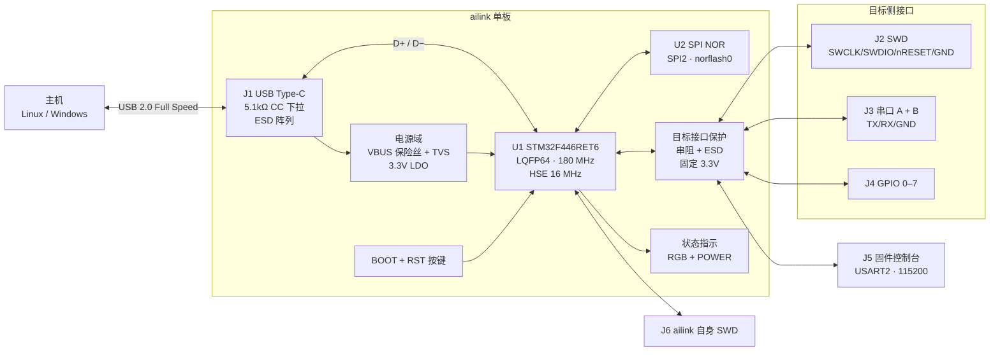

# ailink 硬件产品初版架构设计

| 项目 | 内容 |
| --- | --- |
| 文档状态 | 初版架构设计，待 review |
| 文档版本 | v0.3 |
| 更新日期 | 2026-08-29 |
| 对应固件 | `/home/huan/workspace/ailink`，提交 `4b2c890`（2026-07-29） |
| 主控平台 | STM32F446RET6，LQFP64 |
| 当前阶段 | 需求澄清与架构决策，尚未进入原理图绘制 |
| 用途 | 指导原理图、PCB 与 BOM 设计 |
| 不覆盖 | 固件实现细节（见固件仓库 `docs/design/`）；PCB 布线成品；结构件与外壳详细设计 |

本文所有引用的固件事实均标注来源文件；所有未经实测的数值均标注为估算值。本版遵循“先复现已验证功能，再谈扩展”的原则：必要保护保留，兼容适配、未来预留和需要新增固件状态机的功能不进入初版。

---

## 1. 背景

### 1.1 现有实现

ailink 固件已在 STM32F446RET6 上完成开发与上板验证，功能为「单根 USB 线同时提供两路免驱 CDC 串口、8 路 GPIO 与 CMSIS-DAP v2 调试器，并支持免调试器的 DFU 固件升级」（`README.md:3`）。

2026-07-21 性能基线（`performance-report.md`）：

| 通道 | 实测结果 | 判定 |
| --- | --- | --- |
| CMSIS-DAP v2（SWD 1～12 MHz） | 目标 RAM 写入 95.9 kB/s，读回 96.1 kB/s，25 轮字节一致 | 受 USB 命令往返限制，非 SWD 时钟限制 |
| 单路串口回环（1～11.25 Mbaud） | 6 Mbaud 起进入 USB FS 平台区，峰值 569.27 kB/s | 4 Mbaud 以下由 UART 线速决定 |
| 双路串口并发（各 11.25 Mbaud） | 两路有效载荷合计 587.63 kB/s，USB OUT+IN 1,175.27 kB/s | 无丢字节、无通道饥饿 |
| 固件升级端到端 | 123,796 B 镜像耗时均值 19.974 s，5/5 轮通过 | 升级窗口内四路通道全部离线 |

结论：**功能与协议层已闭环，USB Full Speed 总线带宽是当前的物理上限**，不是固件实现缺陷。

### 1.2 当前硬件形态的问题

现有实现运行在市售 STM32F446RET6 核心板上，配合杜邦线使用。核心板不是为本产品设计的，存在以下问题。

| 编号 | 问题 | 证据 |
| --- | --- | --- |
| P-01 | 核心板晶振实装 16 MHz，与其原理图标注的 8 MHz 不符，时钟树只能靠 `HSE_VALUE` 宏兜底 | `README.md:59`、`AGENTS.md:11` |
| P-02 | 无板载调试探针，ailink 自身首次烧录依赖外接 ST-Link | `AGENTS.md:55` |
| P-03 | 串口无 RTS/CTS 硬件流控，主机连续写入需按现有文档限制在飞字节数；初版接受该已知边界，不改动已验证串口链路 | `README.md:25`、`docs/design/usb-bridge.md:66` |
| P-04 | 主机端口打开但持续不读超过 500 ms 后会丢弃数据；初版维持现有行为，不为低频异常场景增加流控电路和固件改造 | `docs/design/cdc-port-gating.md:31` |
| P-05 | 未实现 VTref 检测，目标板必须独立供电；初版将其明确为连接前提 | `docs/images/wiring-guide.svg:175`、`README.md:34` |
| P-06 | 所有目标接口固定 3.3 V，禁止接入 5 V 信号，不支持 1.8 V / 2.5 V；初版不做任何电平适配 | `docs/images/wiring-guide.svg:60`；D-03 |
| P-07 | CMSIS-DAP 的 SWCLK=PA4、SWDIO=PA5 为非 5 V 容忍引脚（`TTa`）；在“仅限 3.3 V”边界下继续沿用，以避免改动已验证 DAP 固件 | DS10693 Rev 10 Table 10 |
| P-08 | 8 路 GPIO 中的 bit2 落在 PB2（BOOT1）。外部电路在复位期间将该脚拉高会改变启动模式，破坏 ROM DFU 入口 | `bridge_gpio.c:27`；BOOT1 复位采样机制 |
| P-09 | 无 ESD 防护、无串阻、无连接器定义，全部靠杜邦线，11.25 Mbaud 下信号完整性无保障 | 核心板原理图 `docs/refs/sche/Schematic.pdf` |
| P-10 | 核心板 LDO 为 TPS70933（150 mA），MCU 在 180 MHz、外设全开时典型电流即 86 mA，供电余量偏小 | DS10693 Rev 10 Table 24；核心板原理图 |
| P-11 | 核心板携带 SD 卡座、LCD FPC 接口等与本产品无关的电路 | 核心板原理图 |

### 1.3 本硬件项目的目标

将 ailink 从「核心板 + 杜邦线的验证装置」转化为「可重复制造、可稳定复现现有功能的初版单板」。初版优先级依次为：

1. 复用已完成上板验证的 MCU、时钟、引脚和固件路径；
2. 增加电源余量、ESD、串阻、可靠连接器和清晰丝印，避免常见误操作直接损坏；
3. 只修复会阻断烧录或基本使用的问题（例如 GPIO 占用 BOOT1）；
4. 不加入多电压适配、目标供电、硬件流控、SWO、隔离或“以后可能用到”的预留电路。

---

## 2. 需求基线

### 2.1 覆盖范围

- USB 供电、USB 从设备（Device only）形态的单板硬件。
- 两路 UART 桥接通道的 TX、RX 物理接口，固定 3.3 V。
- 一路 SWD 调试输出接口（SWCLK、SWDIO、nRESET），固定 3.3 V。
- 8 路通用 GPIO 的物理接口与保护。
- ailink 自身的烧录、救砖与状态指示。
- 原理图、PCB 布线约束与 BOM 的需求基线。

### 2.2 不覆盖范围

- USB High Speed 或更高带宽的通道扩展（见决策 D-01）。
- JTAG 调试（固件 `DAP_JTAG=0`，`board/ports/DAP_config.h:10`）。
- 电气隔离（USB 侧与目标侧共地）。
- 任何目标接口的电平转换、VTref 检测或自动适配。
- 串口 RTS/CTS 硬件流控与软件模拟流控。
- SWO 与其他调试扩展。
- 目标板供电输出；目标板必须独立供电。
- 逻辑分析仪、示波器、电源分析等测量功能。
- 电池供电与低功耗形态。
- 1.8 V、2.5 V、5 V 等非 3.3 V 目标接口。
- 未使用功能的器件焊盘和兼容性跳线。
- 认证（CE / FCC / USB-IF）与量产测试治具。
- 外壳的详细结构设计（本文仅约束板框与安装孔）。

### 2.3 功能需求

| 编号 | 需求 | 来源 | 验证方式 |
| --- | --- | --- | --- |
| FR-01 | 单个 USB Type-C 接口同时承载两路 CDC 串口、CMSIS-DAP v2、8 路 GPIO 与 DFU 升级通道 | 固件 `README.md:3` | 枚举检查 + 四通道并发 |
| FR-02 | 串口通道 A 沿用 USART6（PC6/PC7），固定 3.3 V，支持 115200～11.25 Mbaud，不提供流控 | 当前固件；`docs/design/usb-bridge.md:24` | 3.3 V 回环压测 |
| FR-03 | 串口通道 B 沿用 USART1（PA9/PA10），固定 3.3 V，支持 115200～11.25 Mbaud，不提供流控 | 当前固件；D-02 | 3.3 V 回环压测 |
| FR-04 | SWD 沿用 PA4/PA5/PA6，提供 SWCLK、SWDIO、nRESET；nRESET 为开漏，全部固定 3.3 V | `DAP_config.h:4-10,124-136` | pyOCD / OpenOCD 连接 3.3 V 目标 |
| FR-05 | 8 路 GPIO 方向由主机逐位配置，仅将占用 BOOT1 的 bit2 从 PB2 改至 PA0 | `bridge_gpio.c:25-29`；P-08 | `ailink-gpio.py dir/set/get` |
| FR-06 | 不依赖任何外部调试器即可完成空板首次烧录（bootloader + app） | P-02 | BOOT0 + dfu-util 全流程 |
| FR-07 | 保留 ailink 自身的 SWD 调试接口，用于板级 bring-up | 开发需要 | ST-Link 连接调试 |
| FR-08 | 固件控制台沿用 USART2（PA2/PA3）并引出 TX/RX/GND | `AGENTS.md:13`；CR-08 | 115200 8N1 日志可读 |
| FR-09 | 状态灯沿用当前 PC0/PC1/PC2 低有效 RGB 连接，PC0 继续兼作 bootloader 故障指示 | `applications/main.c:19-23`；CR-09 | 目视检查 |
| FR-10 | 保留现用 SPI NOR 型号、SPI2 引脚与文件系统 | `applications/fs_init.c`；CR-07 | `norflash0` 挂载成功 |

### 2.4 电气需求

| 编号 | 需求 | 说明 |
| --- | --- | --- |
| ER-01 | 供电仅来自 USB VBUS，整机不向目标板供电 | 不做 PD 协商，不引出 5 V 或 3.3 V 目标电源 |
| ER-02 | 3.3 V LDO 额定输出不低于 300 mA，在整机最大负载下保留至少 2 倍典型电流余量 | 见 4.2 功耗预算 |
| ER-03 | UART、SWD、GPIO、控制台全部固定为 3.3 V CMOS 电平 | 禁止 5 V；不支持 1.8 V / 2.5 V；不做 VTref |
| ER-04 | USB、UART、SWD、GPIO 和控制台等对外接口均配置适合带宽的 ESD 防护 | 保护器件靠近连接器放置 |
| ER-05 | UART、SWD、GPIO 和控制台信号均串联 220 Ω 限流/阻尼电阻 | 单路 3.3 V 输出短接时将电流限制在约 15 mA，同时由样机验证最高速率波形 |
| ER-06 | HSE 使用 16 MHz 晶振，频差不劣于 ±20 ppm | 完全沿用已验证时钟树 |
| ER-07 | USB D+/D− 差分阻抗 90 Ω ±10% | USB 2.0 规范 |
| ER-08 | 不得在 USB D+ 上外挂 1.5 kΩ 上拉电阻 | OTG_FS 使用片内上拉 |
| ER-09 | BOOT0、BOOT1、NRST 在上电和复位期间必须有确定电平 | 确保空板烧录和救砖路径稳定 |
| ER-10 | 未使用 MCU 引脚不引出、不放兼容焊盘，原理图逐一标注 NC | 减少误焊和后续歧义，不为闲置引脚增加固件工作 |

### 2.5 结构与人机需求

| 编号 | 需求 | 说明 |
| --- | --- | --- |
| MR-01 | 板框目标 65 mm × 35 mm 以内，四角 M2 安装孔 | 不为未实现功能扩大板框 |
| MR-02 | USB Type-C 接口位于板子一端，目标侧接口集中于另一端 | 降低走线交叉与耦合 |
| MR-03 | 所有对外引脚在丝印上标注信号名与方向 | 丝印是本产品的主要人机界面 |
| MR-04 | BOOT 与 RST 为独立按键，可单手完成 DFU 进入动作 | 支撑 FR-06 |

### 2.6 固件继承约束

以下为固件当前的既成事实。硬件若不满足，则对应固件模块必须修改；每条均标注影响范围，供第 6 章决策时权衡。

| 编号 | 约束 | 来源 | 违反后果 |
| --- | --- | --- | --- |
| CR-01 | HSE 必须为 16 MHz | `stm32f4xx_hal_conf.h:108`；PLLM 由 `HSE_VALUE/2e6` 推导（`board.c:21,50`） | 需改 `HSE_VALUE`；ROM DFU 时钟自动检测范围需重新确认 |
| CR-02 | USB 使用 OTG_FS，PA11/PA12，无 VBUS 检测脚 | `docs/design/usb-bridge.md:60` | 无 |
| CR-03 | OTG_FS 的 EP0 + 5 对端点已全部占用 | `docs/design/usb-bridge.md:20` | 任何新增 USB 功能接口（MSC、第二 DAP、CAN 桥）都必须先腾出端点 |
| CR-04 | 片内 Flash 布局固定：boot 0x08000000（64 KB），app 0x08010000（448 KB） | `docs/design/ota.md:17-18` | 需重做链接脚本与 `.fw_info` |
| CR-05 | RDP 必须维持 Level 0 | `docs/design/ota.md:78` | ROM DFU 通道失效，救砖路径断裂 |
| CR-06 | BOOT0 可达且 BOOT1（PB2）在复位期间为低 | `docs/design/ota.md:86` | 无法进入 ROM DFU，空板无法烧录 |
| CR-07 | SPI NOR 挂在 SPI2，CS 为 PB12 | `board/ports/spi_flash_init.c:4-5,26` | 需改板级初始化 |
| CR-08 | bootloader 在 USART2（PA2）输出启动日志，并在跳转前复位 USART2 与整个 GPIOA | `bootloader/uart.c:1-26,67-79` | 需改 bootloader 的 UART 实例与 GPIO 端口复位目标 |
| CR-09 | bootloader 恢复模式指示灯为 PC0，低有效 | `bootloader/main.c:111-117` | 需改 bootloader 的 LED 引脚 |
| CR-10 | USB 传输缓冲需 4 字节对齐 | `usb_config.h:26` | 与硬件无关，此处仅作记录 |

---

## 3. 系统架构

### 3.1 系统框图

### 3.2 功能分区

| 分区 | 职责 | 关键器件 |
| --- | --- | --- |
| 主机接口 | USB 2.0 Full Speed 从设备、供电入口 | USB-C 座、ESD 阵列、自恢复保险丝、TVS |
| 主控 | 协议栈、四通道数据泵、DAP 位操作 | STM32F446RET6、16 MHz 晶振 |
| 电源 | 仅生成板内 3.3 V 逻辑电源 | 单路 LDO、去耦电容 |
| 存储 | 完整复现当前固件文件系统 | 现用 SPI NOR |
| 人机 | 复用当前状态指示并提供 DFU 操作 | RGB LED、电源 LED、BOOT/RST 按键 |
| 目标接口 | 固定 3.3 V 直连与基础保护 | 2.54 mm 排针、串阻、ESD |

---

## 4. 关键设计要素

### 4.1 主控与时钟

沿用 STM32F446RET6（LQFP64）。选型理由与替代方案见决策 D-01。

时钟树维持固件现状（`board.c:42-87`）：

| 项 | 值 | 约束来源 |
| --- | --- | --- |
| HSE | 16 MHz 晶振，PH0 / PH1 | CR-01；ROM DFU 的 HSE 自动检测（`docs/design/ota.md:76`） |
| SYSCLK / HCLK | 180 MHz，需 PWR Scale1 + OverDrive | `board.c:43,59-63` |
| APB1 | 45 MHz | 决定 APB1 域 UART 的 OVER8 上限为 5.625 Mbaud |
| APB2 | 90 MHz | 决定 APB2 域 UART 的 OVER8 上限为 11.25 Mbaud |
| USB 48 MHz | PLLSAI，VCO 2 MHz × 192 = 384 MHz，/8 | 主 PLLQ 无法产出 48 MHz |

晶振选型要求：16 MHz、±20 ppm 以内、负载电容 CL 按实物选型，匹配电容按 `C = 2 × (CL − Cstray)` 计算，`Cstray` 按 3～5 pF 估算；串联驱动电阻预留 0 Ω 位置，用于起振裕度调整。

不放置 LSE 晶振及其焊盘。VCAP_1（LQFP64 仅此一路，pin 30）配 2.2 µF 低 ESR 陶瓷电容；4 组 VDD 各配 100 nF；VDDA 经磁珠后配 1 µF + 100 nF，VREF+ 与 VDDA 同网络；VBAT 直接接 3.3 V，不预留电池接口。

LQFP64 无 VDDUSB 独立引脚（DS10693 Rev 10 Table 10 中该行 LQFP64 列为「−」），无需额外电源域。

### 4.2 电源与功耗预算

拓扑只有一路：USB VBUS → 自恢复保险丝 → TVS → 3.3 V LDO → MCU、SPI NOR 与指示灯。VBUS 和 3.3 V 均不输出给目标板。

预算（估算值，需在样机上实测修正）：

| 负载 | 电流估算 | 依据 |
| --- | --- | --- |
| STM32F446 @180 MHz，外设全开，ART 带预取 | 典型 86 mA，25 ℃ 最大 93 mA | DS10693 Rev 10 Table 24 |
| 现用 SPI NOR | 典型约 5 mA，编程/擦除峰值按数据手册取 15 mA | D-06 |
| RGB LED + 电源 LED | 最坏约 8 mA | 每色/每灯按 2 mA |
| 其他静态负载与裕量 | 约 10 mA | 上拉、漏电与估算误差 |
| 整机合计 | 典型约 105 mA，估算最大约 130 mA | 样机实测回填 |

LDO 按 ≥300 mA 额定输出选择，并确认其对所选输入/输出陶瓷电容稳定。按 130 mA 估算，最坏耗散约为 `(5 − 3.3) V × 0.13 A ≈ 0.22 W`；SOT-23-5 可用，但仍须按数据手册铺铜并在样机上测量温升与纹波。

### 4.3 USB 主机接口

- USB Type-C 母座，16 pin，仅 USB 2.0，不引出 SBU 与 SS 对。
- CC1、CC2 各接 5.1 kΩ 下拉，按 UFP 配置，不参与 PD 协商，不读取电流等级。
- D+/D− 走 90 Ω 差分，长度差控制在 2 mm 以内，参考层连续无分割，不打过孔换层（若必须换层则成对换层并就近加回流地过孔）。
- ESD 阵列选低结电容型（≤ 1 pF 量级），放置在座子与 MCU 之间、靠近座子。
- **不外挂 D+ 上拉电阻**（ER-08）。
- 不做 VBUS ADC/比较器检测，也不预留相关分压焊盘（CR-02）。
- 屏蔽壳经 1 MΩ 与 10 nF 并联网络接地，单点连接。

### 4.4 固定 3.3 V 接口边界

UART、SWD、GPIO 和固件控制台全部直接连接 MCU，不经过收发器、MOSFET、模拟开关、跳线或 VTref 检测。所有连接器醒目标注 `3V3 ONLY`。

- 目标板必须独立供电，并与 ailink 共地。
- 禁止连接 5 V 信号；1.8 V / 2.5 V 目标不属于兼容范围。
- 不因 STM32 个别引脚具备 5 V 容忍能力而对外承诺 5 V 输入。
- ailink 与目标均上电后再连接信号；初版不加入掉电隔离电路。
- 不放置任何电平转换器或兼容转换器的预留焊盘。

### 4.5 SWD 接口

- 完全沿用已验证映射：SWCLK=PA4、SWDIO=PA5、nRESET=PA6。
- J2 使用 1×4、2.54 mm 排针，脚序为 `GND / SWCLK / SWDIO / nRESET`。
- 三路信号均串 220 Ω 并配 ESD 防护；nRESET 直接使用 MCU 开漏输出，不增加外置 MOSFET。
- 仅支持 3.3 V SWD 目标，不提供 VTref、SWO、JTAG 或第二种连接器。
- 默认按已验证的 1～12 MHz 工作；最高频率以样机信号完整性测试结果为准。

### 4.6 双路串口

两路串口完全沿用当前固件和 DMA 配置：

| 通道 | UART 实例 | 引脚 | 波特率上限 | 流控 |
| --- | --- | --- | --- | --- |
| 串口 A | USART6 | PC6 TX / PC7 RX | 11.25 Mbaud | 无 |
| 串口 B | USART1 | PA9 TX / PA10 RX | 11.25 Mbaud | 无 |

J3 仅引出两组 TX、RX、GND，不引出 RTS/CTS。各信号串 220 Ω 并配 ESD 阵列，固定 3.3 V。P-03/P-04 的缓存边界继续按现有软件文档处理：主机不得无限制连续写入，也不得在打开端口后长期不读。

### 4.7 通用 GPIO 组

- 保持现有分散映射，只把 bit2 从 PB2（BOOT1）移至空闲的 PA0：bit0～7 = PB0、PB1、PA0、PB8、PB9、PB10、PA1、PA8。
- 这是初版唯一必需的功能引脚迁移，只需修改 `bridge_gpio.c` 的一项映射。
- 每路串 220 Ω 并配 ESD 器件，固定 3.3 V 输入/输出。
- 上电后保持输入高阻，只有收到主机方向配置命令后才切换为输出，降低插拔和接线期间的争用风险。
- 不做整端口重排、5 V 输入承诺、电平转换或转换器预留焊盘。

### 4.8 目标板供电边界

初版不向目标板输出 5 V 或 3.3 V，不放置负载开关、限流芯片、故障回读和电源连接器。目标板必须独立供电；ailink 只与目标连接信号和 GND。这样不会把目标短路、浪涌或负载变化引入 ailink 的 USB 与 3.3 V 电源域。

### 4.9 存储

保留当前已经验证的 SPI NOR 型号与连接，不重新做容量选型：SPI2，SCK=PB13、MISO=PB14、MOSI=PB15、CS=PB12。初版只保证现有 `norflash0` 文件系统挂载，不增加 USB MSC、拖拽烧录或离线编程功能。

### 4.10 指示与按键

| 位号 | 信号 | 引脚 | 含义 |
| --- | --- | --- | --- |
| D8 | LED1/2/3 | PC0/PC1/PC2 | 沿用当前低有效共阳 RGB 状态灯连接与固件行为；PC0 兼作 bootloader 故障指示 |
| D9 | — | 无 MCU 引脚 | 由 3.3 V 轨直接驱动的低电流电源灯 |
| S_BOOT | BOOT0 | BOOT0 | 按下接 3.3 V，常态经 10 kΩ 下拉 |
| S_RST | NRST | NRST | 按下接地，配 100 nF |

不增加用户按键和独立通道活动灯，避免占用引脚和修改已验证指示逻辑。

### 4.11 自举、烧录与救砖

四条路径分层，覆盖从空板到现场的全部场景：

| 场景 | 路径 | 需要的硬件 |
| --- | --- | --- |
| 空板首次烧录 | 按住 BOOT → 点按 RST → 松开 BOOT → 进入 ROM DFU（`0483:df11`）→ `dfu-util` 依次写入 boot（0x08000000）与 app（0x08010000） | 仅一根 USB 线 |
| 日常固件升级 | `ailink-ota.py flash`，经 EP0 请求 `0x63` 写 `RTC->BKP0R` 后复位进 ROM DFU | 仅一根 USB 线 |
| app 变砖（含升级中断电） | bootloader 校验失败自动落入 ROM DFU，PC0 对应灯常亮 | 仅一根 USB 线 |
| bootloader 损坏 | BOOT0 按键进 ROM DFU，或经 J6 用外部探针 | USB 线或探针 |

硬件前提：BOOT0 具备下拉且可被按键拉高；PB2（BOOT1）保持 10 kΩ 下拉且不作他用（CR-06）；RDP 维持 Level 0（CR-05）。

J6 为 ailink 自身的 SWD 接口，使用常见 1×4、2.54 mm 焊盘，默认不焊排针；脚序在丝印中完整标注。

### 4.12 保护与 ESD

| 位置 | 措施 |
| --- | --- |
| VBUS 入口 | 自恢复保险丝（保持电流约 300 mA）+ 5 V TVS |
| USB D+/D− | 低结电容 ESD 阵列，靠近座子 |
| SWD 组（3 路） | 每路串 220 Ω + 低电容 ESD 器件 |
| 双路串口（4 路） | 每路串 220 Ω + 低电容 ESD 阵列 |
| GPIO 组（8 路） | 每路串 220 Ω + ESD 阵列 |
| 控制台（2 路） | 每路串 220 Ω + ESD 器件 |

保护器件不能把固定 3.3 V 接口变成 5 V 容忍接口。串阻用于抑制边沿反射并限制短时误接电流；不得用串阻替代正确接线和电平约束。

### 4.13 连接器与丝印

| 位号 | 类型 | 内容 |
| --- | --- | --- |
| J1 | USB Type-C 母座，16P，SMD | 主机接口 |
| J2 | 1×4，2.54 mm | 目标 SWD：GND / SWCLK / SWDIO / nRESET |
| J3 | 2×3，2.54 mm | 串口 A：TX / RX / GND；串口 B：TX / RX / GND |
| J4 | 2×5，2.54 mm | GPIO0～3 / GND；GPIO4～7 / GND |
| J5 | 1×3，2.54 mm | 固件控制台：CON_TX / CON_RX / GND |
| J6 | 1×4，2.54 mm 焊盘 | ailink 自身 SWD：3V3 / SWDIO / SWCLK / GND，默认不焊排针 |

J2～J5 旁统一醒目标注 `3V3 ONLY / NO POWER OUT`。每一针标注信号名，TX/RX 标注相对 ailink 的方向；J2/J6 的 1 脚使用方形焊盘并在丝印标记，降低反插和错接概率。

### 4.14 PCB 叠层与布线约束

| 项 | 要求 |
| --- | --- |
| 层数 | 4 层：L1 信号 / L2 完整地 / L3 电源与地 / L4 信号；板厚 1.6 mm，1 oz 铜 |
| USB 差分 | 90 Ω ±10%，L1 走线并以 L2 为参考层，参考层不得跨分割 |
| 晶振 | 走线最短，包地，晶振下方各层禁布其他信号，匹配电容就近接同一地平面 |
| 外部信号 | MCU → 串阻 → ESD → 连接器，支路尽量短；ESD 必须靠近连接器 |
| 电源 | LDO 输入输出电容按数据手册紧邻引脚；3.3 V 主干按 300 mA 留裕量 |
| 地 | 单一地平面，不做分割；USB 屏蔽壳单点接地 |
| 测试点 | 仅保留 bring-up 必需的 VBUS、3.3 V、GND、NRST、BOOT0、USB D+/D− |

---

## 5. 引脚分配

### 5.1 已用引脚表

| 引脚 | 网络名 | 复用功能 | 方向 | 说明 |
| --- | --- | --- | --- | --- |
| PA0 | TGPIO2 | GPIO | 双向 | GPIO bit 2；替代原 PB2 |
| PA1 | TGPIO6 | GPIO | 双向 | GPIO bit 6 |
| PA2 | CON_TX | USART2_TX，AF7 | 输出 | 固件与 bootloader 控制台 |
| PA3 | CON_RX | USART2_RX，AF7 | 输入 | 固件控制台接收 |
| PA4 | T_SWCLK | GPIO | 输出 | 目标 SWD 时钟；`TTa`，仅限 3.3 V |
| PA5 | T_SWDIO | GPIO | 双向 | 目标 SWD 数据；`TTa`，仅限 3.3 V |
| PA6 | T_nRESET | GPIO | 开漏输出 | 目标复位 |
| PA8 | TGPIO7 | GPIO | 双向 | GPIO bit 7 |
| PA9 | B_TX | USART1_TX，AF7 | 输出 | 串口 B 发送 |
| PA10 | B_RX | USART1_RX，AF7 | 输入 | 串口 B 接收 |
| PA11 | USB_DM | OTG_FS_DM，AF10 | 双向 | USB |
| PA12 | USB_DP | OTG_FS_DP，AF10 | 双向 | USB |
| PA13 | MCU_SWDIO | SYS_JTMS-SWDIO | 双向 | ailink 自身调试 |
| PA14 | MCU_SWCLK | SYS_JTCK-SWCLK | 输入 | ailink 自身调试 |
| PB0 | TGPIO0 | GPIO | 双向 | GPIO bit 0 |
| PB1 | TGPIO1 | GPIO | 双向 | GPIO bit 1 |
| PB2 | BOOT1 | — | — | 10 kΩ 下拉，不作他用（CR-06） |
| PB8 | TGPIO3 | GPIO | 双向 | GPIO bit 3 |
| PB9 | TGPIO4 | GPIO | 双向 | GPIO bit 4 |
| PB10 | TGPIO5 | GPIO | 双向 | GPIO bit 5 |
| PB12 | FLASH_CS | GPIO | 输出 | SPI NOR 片选（CR-07） |
| PB13 | SPI2_SCK | SPI2_SCK，AF5 | 输出 | SPI NOR |
| PB14 | SPI2_MISO | SPI2_MISO，AF5 | 输入 | SPI NOR |
| PB15 | SPI2_MOSI | SPI2_MOSI，AF5 | 输出 | SPI NOR |
| PC0 | LED1 | GPIO | 输出 | RGB 状态灯，低有效；bootloader 故障指示 |
| PC1 | LED2 | GPIO | 输出 | RGB 状态灯，低有效 |
| PC2 | LED3 | GPIO | 输出 | RGB 状态灯，低有效 |
| PC6 | A_TX | USART6_TX，AF8 | 输出 | 串口 A 发送 |
| PC7 | A_RX | USART6_RX，AF8 | 输入 | 串口 A 接收 |
| PH0 | OSC_IN | RCC_OSC_IN | — | HSE 16 MHz |
| PH1 | OSC_OUT | RCC_OSC_OUT | — | HSE 16 MHz |
| BOOT0 | BOOT0 | — | 输入 | 10 kΩ 下拉 + 按键至 3.3 V |
| NRST | NRST | — | 双向 | 按键 + 100 nF |

其余引脚不引出、不放功能预留焊盘。原理图应对所有未使用引脚逐一标注 NC，避免误判为漏连；初版不为这些闲置引脚增加初始化代码。

### 5.2 与当前固件的差异及固件工作项

| 项 | 当前固件 | 本设计 | 固件改动 |
| --- | --- | --- | --- |
| GPIO bit2 | PB2（BOOT1） | PA0 | 仅替换 `bridge_gpio.c` 引脚表中的一项 |
| 串口 A/B、控制台 | USART6 / USART1 / USART2 | 完全沿用 | 无 |
| DAP、状态灯、SPI NOR | PA4～PA6 / PC0～PC2 / SPI2 | 完全沿用 | 无 |
| USB、Flash 布局、OTA | 当前已验证实现 | 完全沿用 | 无 |

初版不新增 ADC、流控、目标供电、SWO 或电平转换控制代码。除 GPIO bit2 外，板级引脚与当前固件一致；协议栈、DMA、数据泵、bootloader、OTA 和主机工具均不改动。

---

## 6. 关键决策记录

本章记录初版已经收敛的边界。原则是优先复用现有验证结果；只有安全、供电和可制造性相关项目允许增加硬件。

### D-01　主控选型

| 项 | 内容 |
| --- | --- |
| **决策** | 继续使用 STM32F446RET6（LQFP64） |
| 理由 | 固件、时钟、USB、DAP 和 OTA 已完成上板验证；更换型号或封装会扩大首板风险 |
| 接受的边界 | USB Full Speed 带宽上限、端点已满；初版不扩展 USB 功能 |

### D-02　串口流控与波特率取舍

| 项 | 内容 |
| --- | --- |
| **决策** | 沿用 USART6（A）+ USART1（B），两路均最高 11.25 Mbaud、均无 RTS/CTS |
| 理由 | 这是当前已完成并发压力测试的配置，不迁移 UART、不重分配 DMA、不修改 bootloader 控制台 |
| 接受的边界 | 主机按现有文档限制在飞数据；长期不读场景允许按现有策略丢弃 |

### D-03　目标接口电平策略

| 项 | 内容 |
| --- | --- |
| **决策** | UART、SWD、GPIO、控制台全部固定 3.3 V 直连 |
| 删除 | 所有电平转换器、VTref 检测、方向/OE 控制、转换跳线及其预留焊盘 |
| 理由 | 与当前验证硬件一致，器件更少、路径更短、无需新增固件时序 |
| 产品边界 | 禁止 5 V，不支持 1.8 V / 2.5 V；目标板独立供电并与 ailink 共地 |

### D-04　GPIO 组策略

| 项 | 内容 |
| --- | --- |
| **决策** | 固定 3.3 V 直连，不预留转换器 |
| 引脚策略 | 只将 GPIO bit2 从 PB2 移至 PA0，其余七路保持当前映射 |
| 理由 | 消除 BOOT1 启动风险，同时把固件改动限制为一个表项 |

### D-05　晶振频率

| 项 | 内容 |
| --- | --- |
| **决策** | **16 MHz，±20 ppm 以内** |
| 理由 | 与固件 `HSE_VALUE` 一致（CR-01），PLLM 分频推导无需改动；ROM DFU 已在 16 MHz 下完成端到端验证（`docs/design/ota.md:76`）。同时消除 P-01 描述的「实装与原理图不符」问题——本设计的原理图将标注 16 MHz |

### D-06　SPI NOR 保留与容量

| 项 | 内容 |
| --- | --- |
| **决策** | 保留当前 W25Q64（64 Mbit）及 SPI2 引脚 |
| 理由 | 驱动、探测和文件系统均已验证；首版不为节省少量 BOM 成本重新选型 |
| 边界 | 不增加 MSC、拖拽烧录或离线编程 |

### D-07　ailink 自身 SWD 接口形式

| 项 | 内容 |
| --- | --- |
| **决策** | 1×4、2.54 mm 标准焊盘，默认不焊排针 |
| 脚序 | 3V3 / SWDIO / SWCLK / GND |
| 理由 | 普通杜邦线或 ST-Link 即可使用，不依赖专用夹具 |

### D-08　目标供电能力

| 项 | 内容 |
| --- | --- |
| **决策** | 不提供，目标必须独立供电 |
| 删除 | 5 V/3.3 V 输出、负载开关、故障回读、互锁固件与电源连接器 |
| 理由 | 隔离目标负载和短路风险，缩小电源设计范围 |

### D-09　3.3 V 电源拓扑

| 项 | 内容 |
| --- | --- |
| **决策** | 单路 3.3 V LDO，额定输出 ≥300 mA |
| 理由 | 最大估算负载约 130 mA、耗散约 0.22 W；LDO 元件少、布局简单且无开关噪声 |
| 选型约束 | 使用陶瓷电容稳定、具过流和过温保护；样机验证纹波与温升 |

### D-10　USB 标识与销售定位

| 项 | 内容 |
| --- | --- |
| 事实 | 当前 VID/PID 为 `1209:0010`，属 pid.codes 测试号，明确「不可用于产品销售」（`README.md:11`） |
| **初版决策** | 维持测试号，仅用于开发验证，不销售 |
| 硬件影响 | 无。序列号取 MCU 96-bit UID，不需要 EEPROM |
| 后续 | 确认对外分发时再申请正式 PID，不影响首板 |

### D-11　板载 LED 形式

| 项 | 内容 |
| --- | --- |
| **决策** | 沿用 PC0/PC1/PC2 低有效 RGB LED，另加一只电源 LED |
| 理由 | 应用和 bootloader 已使用该连接；无需改固件，电源灯便于首板排障 |

---

## 7. 初版 BOM 骨架

初版 BOM 不放置 DNP 兼容器件；表中“待定型”只允许在同一功能和电气边界内选择具体料号。

| 类别 | 位号 | 型号或规格 | 数量 | 说明 |
| --- | --- | --- | --- | --- |
| 主控 | U1 | STM32F446RET6，LQFP64 | 1 | D-01 |
| 存储 | U2 | W25Q64，SOIC-8 | 1 | 沿用现状；D-06 |
| 电源 | U3 | 3.3 V LDO，≥300 mA，陶瓷电容稳定，具过流/过温保护（待定型） | 1 | D-09 |
| 时钟 | X1 | 16 MHz 晶振，±20 ppm | 1 | D-05 |
| 保护 | F1 | 自恢复保险丝，保持电流约 300 mA（待定型） | 1 | VBUS |
| 保护 | D1 | USB 专用低容 ESD 阵列 | 1 | D+/D− |
| 保护 | D2～D6 | 3.3 V 信号 ESD 阵列（待定型） | 5 | SWD、UART、GPIO、控制台按通道归并 |
| 保护 | D7 | TVS，VBUS | 1 | — |
| 指示 | D8 | 低有效共阳 RGB LED | 1 | 沿用 PC0/PC1/PC2 |
| 指示 | D9 | 低电流 LED | 1 | 3.3 V 电源指示 |
| 连接器 | J1 | USB Type-C 母座，16P，USB 2.0 | 1 | — |
| 连接器 | J2 | 1×4，2.54 mm 排针 | 1 | 目标 SWD |
| 连接器 | J3 | 2×3，2.54 mm 排针 | 1 | 双路串口 |
| 连接器 | J4 | 2×5，2.54 mm 排针 | 1 | GPIO |
| 连接器 | J5 | 1×3，2.54 mm 排针 | 1 | 控制台 |
| 连接器 | J6 | 1×4，2.54 mm 焊盘 | 0 | ailink 自身 SWD，默认不焊排针 |
| 开关 | S_BOOT、S_RST | 轻触按键，4.2 × 3.2 mm | 2 | — |
| 无源 | — | 电阻、电容、磁珠 | 约 45 | 去耦、串阻、上下拉、滤波 |

### 关键无源件清单要点

| 用途 | 参数 | 数量 |
| --- | --- | --- |
| LDO 输入/输出 | 按最终 LDO 数据手册，优先 0603/0805 陶瓷电容 | 1 组 |
| VDD 去耦 | 100 nF，0603 | 4 |
| VCAP_1 | 2.2 µF，低 ESR | 1 |
| VDDA 滤波 | 磁珠 + 1 µF + 100 nF | 1 组 |
| 晶振匹配 | 按 CL 计算，0603 | 2 |
| 晶振驱动电阻 | 0 Ω 预留 | 1 |
| USB CC 下拉 | 5.1 kΩ ±1% | 2 |
| BOOT0 下拉、BOOT1 下拉 | 10 kΩ | 2 |
| NRST 滤波 | 100 nF | 1 |
| 对外信号串阻 | 220 Ω | 17 |
| LED 限流 | 按每路约 2 mA 设计 | 4 |

---

## 8. 硬件验收方法

以下为硬件层验收，固件功能验收沿用固件仓库既有方法。

| 编号 | 测试项 | 方法 | 判定条件 |
| --- | --- | --- | --- |
| HV-01 | 上电与电源轨 | 空载与满载下测量 3.3 V 轨、纹波与 LDO 温升 | 3.3 V ±3%；LDO 壳温在 25 ℃ 环境下的稳态值待定型后回填 |
| HV-02 | 空板烧录 | 未烧录的空板执行 BOOT0 + RST 进 ROM DFU，用 dfu-util 依次写入 boot 与 app | `0483:df11` 枚举成功，写入后重枚举为设定的 VID/PID |
| HV-03 | USB 枚举 | 检查复合设备五接口枚举与 `/dev/serial/by-id/` 路径 | 两路 ttyACM + DAP 接口全部出现，序列号为 MCU UID |
| HV-04 | 串口 A 吞吐 | 使用 3.3 V 电平做 TX-RX 回环，覆盖 1 / 2 / 4 / 6 / 8 / 11.25 Mbaud | 各档字节一致；吞吐不低于既有基线的 95% |
| HV-05 | 串口 B 吞吐 | 使用 3.3 V 电平做 TX-RX 回环，覆盖 1 / 2 / 4 / 6 / 8 / 11.25 Mbaud | 各档字节一致；吞吐不低于既有基线的 95% |
| HV-06 | 双路并发 | 两路同时满载 | 无丢字节、无通道饥饿 |
| HV-07 | SWD 功能与频率 | 经 J2 连接已独立供电的 3.3 V 目标，覆盖 1～12 MHz | 目标识别、halt、RAM 读写、resume 全部通过 |
| HV-08 | GPIO 与 BOOT1 | 8 路逐位配置、写入和读回；外部拉动各 GPIO 后执行 BOOT0 进 DFU | GPIO 正常；任何 GPIO 状态均不影响 ROM DFU |
| HV-09 | 控制台与状态灯 | 读取 USART2 115200 日志并检查 RGB/电源灯 | 日志无乱码；应用和 bootloader 指示与当前固件一致 |
| HV-10 | SPI NOR | 连续执行探测、格式化、写入、掉电重启和读回 | `norflash0` 稳定挂载且数据一致 |
| HV-11 | 救砖路径 | 刷入截断镜像后复位 | bootloader 判定失败、PC0 对应灯常亮、落入 ROM DFU，重刷救回 |
| HV-12 | 信号完整性 | 在 11.25 Mbaud UART 与 12 MHz SWD 下观察连接器端波形 | 电平、过冲、振铃和建立时间满足 MCU 与目标输入规格 |
| HV-13 | 接口边界与短接保护 | 检查 J2～J5 引脚与丝印，确认无目标电源输出；对每个 3.3 V 输出逐路短接 GND 1 秒后复测 | 无 5 V、VTref、RTS/CTS、SWO 或目标电源引脚；短接后功能正常、引脚无永久损伤 |
| HV-14 | 稳定性老化 | 双路 UART 并发回环，同时循环执行 SWD 读写和 GPIO 操作，持续 24 小时 | 无复位、死机、USB 掉线、数据错误或异常温升 |
| HV-15 | ESD 与插拔 | 对 USB 和目标接口执行约定等级的接触放电，并做至少 100 次 USB/目标连接器插拔 | 功能保持正常，连接器无松动，USB 可稳定重枚举 |

---

## 9. 待确认事项

功能边界已经收敛，投板前只确认会影响采购、装配和机械尺寸的事项：

1. **LDO 具体型号及其输入/输出电容**：按 130 mA 最大估算负载、5 V 输入和样机温升定型。
2. **ESD/TVS 具体型号与验收等级**：在低电容、钳位能力、封装和成本之间定型。
3. **连接器方向**：J2～J5 使用直针还是弯针；是否需要带护罩版本以降低错接。
4. **板框与外壳**：是否首版只做裸板；若需要外壳，再确认安装孔、连接器高度和开孔。
5. **生产数量与装配方式**：决定被动器件优先 0603 还是改用更小封装。
6. **USB 标识**：初版测试号只用于开发验证；对外分发前必须另行解决 VID/PID。
7. **工作环境**：温度范围、线缆长度和 ESD 等级，用于确定 HV-01、HV-12、HV-15 的最终阈值。

---

## 10. 参考资料

- [STM32F446xC/E 数据手册 DS10693 Rev 10](https://www.st.com/resource/en/datasheet/stm32f446re.pdf)
- [AN2606：STM32 微控制器系统存储器自举模式](https://www.st.com/resource/en/application_note/cd00167594.pdf)
- [USB Type-C Cable and Connector Specification](https://www.usb.org/documents)
- 固件仓库设计文档：`/home/huan/workspace/ailink/docs/design/usb-bridge.md`、`ota.md`、`cdc-port-gating.md`
- 固件性能基线：`/home/huan/workspace/ailink/performance-report.md`
- 现用核心板原理图：`/home/huan/workspace/ailink/docs/refs/sche/Schematic.pdf`
